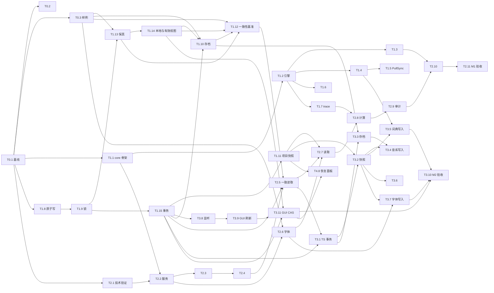

# Conlang Maker MCP · 执行计划

| 项目 | 内容 |
| --- | --- |
| 版本 | v1.1（2026-11-11 审查修订） |
| 依据 | [BRD.md](./BRD.md)、[PRD.md](./PRD.md) v0.3（Q1–Q7 沿用确认记录，审查修订按任务验收） |
| 读者 | 执行任务的模型或开发者 |
| 执行日志 | [EXECUTION_LOG.md](./EXECUTION_LOG.md)（每完成一个任务追加一条） |

---

## 0. 执行者必读

### 0.1 文档优先级

1. **行为以 PRD 为准**：工具语义、数据格式、错误码。
2. **顺序、文件布局、接口签名以本计划为准**。
3. 两者都没写到时，按现有 Rust 行为和 PRD 的数据安全约束实现，在执行日志的「偏差与决定」里记录。本计划已定义的锁、事务、快照和扩展字段格式可直接落实。新增不兼容格式或需要负责人作出的产品语义选择时再确认。

### 0.2 环境事实（2026-11-11 已核实）

| 项 | 值 |
| --- | --- |
| 仓库 | `/Users/jrdamocles/code/conlang-maker/conlang-maker`（GitHub 公开仓库 `wumail/conlang-maker`） |
| 工具链 | bun 1.3.9、node 22.22、cargo 1.93、Python fontTools 4.61（fontforge 不在 PATH） |
| 前端 | React 19 + zustand + Vite 7，TS 5.8 strict；`tsconfig.json` 只包含 `src`，排除 `*.test.ts` |
| 测试 | `bun test`（目前 10 项）；`cd src-tauri && cargo test`（目前 17 项） |
| 构建 | `npm run build` = i18n-check → version-check → tsc → vite build |
| 已知问题 | i18n-check 报 `titlebar.close / maximize / minimize` 缺键，但不阻断构建（T0.2 修） |
| 工作区状态 | 有约 54 个未提交改动（上一轮「书写系统改为字体驱动」的重构），**T0.1 处理** |
| 真实数据 | Terrax 工作区 `/Users/jrdamocles/code/TERRAX/人工语言/Terrax双语系工作区`（**只读**） |
| 注册表 | `~/Library/Application Support/com.conlang-maker/registry.json` |

### 0.3 硬性规则

1. **真实数据只读**：不得修改 `/Users/jrdamocles/code/TERRAX/` 下的任何文件。需要用真实数据验收时，先 `cp -R` 到 `mktemp -d` 目录，在副本上操作。
2. **不得把用户数据提交进仓库**（仓库是公开的）。所有入库的样例数据都必须是合成数据（T0.3）。
3. **不得破坏 GUI**：每个任务完成后跑「全量验证」（§0.4），全部通过才算完成。
4. **一个任务一个提交**，提交信息格式：`<type>(<scope>): <摘要> [T编号]`，例如 `feat(core): extract pull sync diff [T1.5]`。不要顺手改任务范围以外的代码。
5. **新增 UI 文案必须中英文同时加**（`src/i18n/en.ts` 和 `src/i18n/zh.ts`），i18n-check 不得新增报错。
6. **不得自行提交别人未提交的改动**（T0.1 由负责人决定）。
7. 依赖、API 或测试问题先在任务范围内诊断和修复，并记录实际签名与偏差。只有缺少必要授权、外部条件或产品决策而无法继续时，列明已完成项、阻塞证据和剩余任务后交回。

### 0.4 全量验证命令（V-ALL）

```bash
bun test
(cd src-tauri && cargo test)
npm run build
bun run core:check              # T1.1 之后
bun run mcp:check && bun run mcp:test   # T2.2 之后
```

### 0.5 任务卡字段说明

- **依赖**：必须先完成的任务
- **车道**：可以并行推进的工作线（§2）
- **规模**：S ≤ 2 小时；M ≤ 1 天；L 1–3 天
- **先读**：开工前必须读的文件
- **验收**：逐条可检查；全部满足并通过 V-ALL 才算完成

---

## 1. 任务总览

| ID | 任务 | 里程碑 | 依赖 | 车道 | 规模 |
| --- | --- | --- | --- | --- | --- |
| T0.1 | 基线确认（负责人决定如何处理未提交改动） | 准备 | — | — | S |
| T0.2 | 修复 titlebar 缺键 | 准备 | T0.1 | C | S |
| T0.3 | 合成样例工作区与测试字体 | 准备 | T0.1 | F | M |
| T1.1 | `src/core` 骨架与纯净性检查 | M0 | T0.1 | C | S |
| T1.2 | 迁移纯引擎到 `src/core` | M0 | T1.1 | C | M |
| T1.3 | 拆分 llmPrompt / exportDic 的 DOM 部分 | M0 | T1.2 | C | S |
| T1.4 | 词条规范化、ID 与时间戳工具 | M0 | T1.2 | C | S |
| T1.5 | 抽取 Pull Sync 差异计算 | M0 | T1.4 | C | M |
| T1.6 | 抽取语料自动标注 | M0 | T1.2 | C | M |
| T1.7 | 罗马音转换 trace | M0 | T1.2 | C | M |
| T1.8 | Rust `atomic_write` 唯一临时文件名 | M0 | T0.1 | R | S |
| T1.9 | 项目锁（Rust 侧） | M0 | T1.8 | R | M |
| T1.10 | 旧版字段存档迁移（Rust 侧） | M0 | T1.14、T1.15、T0.3 | R | M |
| T1.11 | 语言/项目快照与回收站恢复（Rust 侧） | M0 | T1.15 | R | L |
| T1.12 | 保真一致性基准与双向测试框架 | M0 | T0.3、T1.10、T1.13、T1.14 | R | M |
| T1.13 | Rust/GUI 未知字段保真 | M0 | T0.3、T1.9 | R | L |
| T1.14 | 本地配置与有效继承视图分离 | M0 | T1.13 | R | M |
| T1.15 | Rust 项目事务、恢复与一致读取 | M0 | T1.9 | R | L |
| T2.1 | 技术验证：MCP SDK / harfbuzzjs / bun compile | M1 | T0.1 | M | S |
| T2.2 | MCP 服务骨架与配置 | M1 | T1.1、T2.1 | M | M |
| T2.3 | 通用约定：错误、分页、裁剪、体量控制 | M1 | T2.2 | M | S |
| T2.4 | 注册表与寻址 | M1 | T2.3 | M | S |
| T2.5 | 一致读取、TS 协调锁与一致性测试 | M1 | T2.4、T1.12、T1.15 | M | L |
| T2.6 | 字体模块 | M1 | T2.2、T0.3 | M | M |
| T2.7 | 只读数据工具 | M1 | T2.5、T2.6、T1.11 | M | M |
| T2.8 | 计算工具 | M1 | T2.7、T1.7 | M | M |
| T2.9 | 字体覆盖审计 | M1 | T2.8 | M | L |
| T2.10 | 资源与审计 Prompt | M1 | T2.9、T1.3 | M | S |
| T2.11 | M1 真实数据验收与 DSH 接入说明 | M1 | T2.10 | M | M |
| T3.1 | TS 写入事务、恢复与审计 | M2 | T2.5、T1.15 | M | L |
| T3.2 | TS 语言/项目快照与恢复 | M2 | T3.1、T1.11 | M | M |
| T3.3 | TS 旧版字段存档迁移 | M2 | T3.1、T1.10 | M | S |
| T3.4 | 音系 / 映射 / 字形标注写入工具 | M2 | T3.2、T3.3 | M | M |
| T3.5 | 词典写入工具 | M2 | T3.2、T1.4 | M | M |
| T3.6 | 语法与 SCA 写入工具 | M2 | T3.2 | M | S |
| T3.7 | 字体导入与事务化批量更新 | M2 | T3.2、T2.6 | M | M |
| T3.8 | GUI 外部变更监听（Rust） | M2 | T1.15 | G | M |
| T3.9 | GUI 自动刷新与冲突提示（前端） | M2 | T3.8 | G | M |
| T3.10 | 并发、崩溃恢复与重试验收 | M2 | T3.5、T3.7、T3.11 | M | L |
| T3.11 | GUI 全保存入口版本校验 | M2 | T3.9、T1.14、T1.15 | G | L |
| T4.1 | 语言派生 / 修改 / 删除与恢复工具 | M3 | T3.2、T1.11 | M | M |
| T4.2 | Pull Sync / 父语言差异 / 借词工具 | M3 | T3.5、T1.5 | M | M |
| T4.3 | 语料写入与自动标注工具 | M3 | T3.2、T1.6 | M | S |
| T4.4 | 其余计算工具 | M3 | T2.8、T3.4 | M | M |
| T4.5 | 导入导出工具 | M3 | T3.2、T1.3 | M | M |
| T4.6 | 快照、注册表、项目管理工具 | M3 | T3.2 | M | M |
| T4.7 | 其余资源与 Prompts | M3 | T4.1–T4.6 | M | S |
| T4.8 | GUI 快照与项目恢复面板 | M3 | T3.11、T1.11 | G | M |
| T4.9 | 覆盖矩阵自动校验 | M3 | T4.7 | M | S |
| T5.1 | 多平台可执行文件与 Tauri externalBin | M4 | T4.9 | M | M |
| T5.2 | GUI：MCP 设置页 | M4 | T5.1 | G | M |
| T5.3 | 中英文用户文档 | M4 | T5.1 | D | S |
| T5.4 | 发布验收 | M4 | 全部 | — | S |

---

## 2. 依赖图与并行车道



图展示准备阶段至 M2 及恢复面板的关键依赖，完整依赖以 §1 和任务卡为准。

| 车道 | 内容 | 建议执行者 |
| --- | --- | --- |
| C（core） | T0.2、T1.1–T1.7 | 熟悉 React / TS 的模型 |
| R（Rust 与存储契约） | T1.8–T1.15，T1.13–T1.14 同时涉及 GUI store | 熟悉 Rust / Tauri / TS 的模型 |
| F（样例） | T0.3 | 任意模型 |
| M（MCP） | T2.x、T3.1–T3.7、T3.10、T4.1–T4.7、T4.9、T5.1 | 主力模型 |
| G（GUI） | T3.8、T3.9、T3.11、T4.8、T5.2 | 熟悉 Tauri / React 的模型 |
| D（文档） | T5.3 | 任意模型 |

T0.1 完成后，C、R、F 三条车道和 T2.1 可以同时开工。

---

## 3. 共享规范（多个任务引用）

### 3.1 ID 与时间戳约定（与现有 GUI 一致，T1.4 实现）

| 对象 | 格式 | 现有出处 |
| --- | --- | --- |
| entry_id、sense_id、rule_id（映射 / 音位变体 / 屈折 / 派生）、map_id、chapter_id、tone_id | `crypto.randomUUID()` | QuickEntry、RomanizationEditor 等 |
| pos_id / dim_id / val_id / slot_id / class_id | `pos_` / `dim_` / `val_` / `slot_` / `conj_` + UUID 前 8 位 | POSSection、DimensionEditor 等 |
| language_id | `lang_` + `Date.now().toString(36)` | FamilyTree.tsx:171 |
| 词条时间戳 | ISO 8601 字符串（与 GUI 现有写法一致，T1.4 先确认） | lexiconStore |

### 3.2 项目锁协议（T1.9 Rust、T2.5 TS 协调锁）

- 项目根目录为 `.conlang` 所在目录，锁位于 `<project>/.conlang-maker/lock/`。Rust 与 TS 先按规范路径取得进程内项目互斥量。
- 每次尝试生成全新 128-bit nonce。owner 文件名为 `owner-<host_key>-<pid>-<nonce>.json`，内容包含相同身份、tool、acquired_at。host_key 采用两端一致的稳定本机身份，PID 检测处于相同本机命名空间。T1.9 固定编码并跨平台验证。
- 尝试 `mkdir` 后，用独占创建方式发布本次 owner 文件。目录已存在也按此竞争协议处理。只有本次确实创建成功的文件才归本次尝试所有，EEXIST 时不得清理那个候选文件。
- 发布后发起一次全新的完整目录枚举。成功枚举且唯一 owner 恰为本次文件时才能进入。枚举失败或发现其他 owner 时，撤去本次已创建的 owner，尝试空目录 rmdir，退避后重试。每 50ms 加随机抖动，最多等待 5 秒，超时报 `LOCKED`。
- owner 发布后保持不可变，在全部临界区及嵌套调用结束前持续存在。释放只 unlink 本次成功创建的精确 owner，再尝试空目录 rmdir。所有阶段均禁止递归删除锁目录。
- 回收只 unlink 已确证属于本机死亡进程的精确 owner 文件，再尝试空目录 rmdir。身份编码在文件名中，JSON 为空或截断仍可判断。PID 存活、权限不足、异机或未知结果均等待。Windows 同样必须可靠判断进程死亡，mtime 不作为强制删除 owner 的依据。
- 空目录在 30 秒发布宽限后可尝试空目录 rmdir。被打断的发布者须重新独占创建并核验唯一 owner。清理失效目录时出现 ENOENT / ENOTEMPTY 属于竞争结果。
- 重入仅属于同一执行上下文，Rust 使用显式 guard/context，TS 使用显式上下文或 AsyncLocalStorage。共享 PID 的其他并行任务排队，外层任务退出和取消前须等待嵌套工作结束。
- 所有写入、快照、恢复及一致读取采用同一个锁。读取在锁内采集数据与版本后释放，再执行重计算。
- 协议面向遵守该协议的本机进程与本地文件系统。验证目标平台独占创建、空目录删除、稳定 owner 在新枚举中可见的语义，并用可控屏障测试发布、回收、目录重建和取消时序。测试始终断言临界区活动计数 ≤ 1。

### 3.3 单文件原子替换（T1.8 Rust、T3.1 TS）

临时文件 `<目标文件>.<pid>.<nonce>.tmp` 与目标同目录，使用独占创建并在碰撞时换 nonce 重试。写入后 fsync，再 rename。失败时仅清理本次临时文件。平台支持时同步父目录。跨桶词条、语料正文与索引、字体替换及工作区操作由 §3.9 的事务统筹全部文件和目录动作。

### 3.4 revision 与重试

- 单文件以原始字节 SHA-256 前 16 位为版本，不存在时为 `missing`。词典按文件名排序，把 `文件名:文件revision\n` 序列再哈希。语料正文与索引分别返回版本。拓扑版本来自实际 `.conlang` 原文。
- 所有实际写入必须携带读取版本。多目标用 `expected_revisions`，创建目标也核验 `missing`。缺少返回 `REVISION_REQUIRED`，不符返回 `CONFLICT`。dry_run 返回完整 `base_revisions`，提交时核验目标及计算依赖。
- 继承结果返回本地 revision、effective_revision 与 dependencies。effective_revision 由本地、祖先源文件、父链和相关布局版本确定。普通保存以本地内容为基准，应用计算结果还校验其依赖。
- `force` 仅记录用户显式覆盖意图，仍校验其确认时的磁盘版本。每次新请求携带客户端生成的 operation_id，相同请求重试返回持久化结果，同 ID 不同请求返回 VALIDATION。
- 写入结果遵循 PRD §4.2。提交结果与审计事件进入事务记录，响应丢失后可安全重试。事务材料清理后继续保留 operation_id、请求摘要和结果的去重凭据，并定义保留期及过期响应，避免重试被当成新写入。

### 3.5 旧版字段存档格式（T1.10、T3.3）

- 废弃字段清单：顶层 `writing_systems`、`font_encoding_profiles`；映射表 `writing_system_id`；规则 `output_phonemes`、`phonemes_confirmed`、`writing_override`、`writing_overrides`。
- 触发：写 `phonology.json` 时，**磁盘上的旧文件**含有上述任一字段，并且这次写入不再包含它们。
- 存档路径：`<语言目录>/.conlang-maker/legacy/writing-<YYYYMMDDTHHMMSS>-<operation_id>.json`
- 存档内容：

```json
{
  "format": "conlang-maker/legacy-writing@1",
  "archived_at": "2026-11-11T12:00:00+08:00",
  "archived_by": "gui | mcp",
  "source_file": "phonology.json",
  "source_sha256": "<旧文件完整 SHA-256>",
  "top_level": { "writing_systems": [], "font_encoding_profiles": [] },
  "maps": [ { "map_id": "…", "name": "…", "writing_system_id": "lamitic" } ],
  "rules": [ { "map_id": "…", "rule_id": "…", "input": "ch", "output_phoneme": "tʃ",
               "output_phonemes": [], "phonemes_confirmed": false, "writing_override": null } ],
  "needs_review": [ { "map_id": "…", "rule_id": "…", "input": "ch", "output_phoneme": "tʃ",
                      "reason": "phonemes_unconfirmed" } ],
  "migrated_glyph_annotations": 296
}
```

- 只记录真正存在的字段（缺失的字段不要写 `null`）。
- 存档与本地音系迁移纳入同一事务。迁移来源仅为本语言旧字段，有效视图中的祖先标注由 §3.10 单独解析。存档失败则整次写入失败。

### 3.6 语言级与项目级快照（T1.11 Rust、T3.2 TS）

- 语言级位置为 `<lang>/.oplog/snap_<log_id>/`。manifest v1 声明 `scope`、origin、created_at、font_file 及每个路径原本的存在状态。scope 对应 lexicon / phonology / grammar / sca / corpus / font。旧无 manifest 快照按 lexicon 读取，已有 manifest v1 的缺省字段按旧语义兼容。
- 项目级位置为 `<project>/.conlang-maker/snapshots/snap_<snapshot_id>/`，manifest v2 使用 `level: "project"`，记录 `.conlang`、受影响 language_id/原 LanguageEntry、目录原存在状态、项目相对路径以及恢复所需原始数据。派生、改父、删除/恢复语言、整包导入及跨语言批量操作使用项目范围。
- 快照保留原始字节及哈希，存在状态区分缺失文件与空文件。font 原本没有自有文件时恢复为没有自有文件，新语言目录恢复为缺失。项目数据副本排除锁、事务自身与递归历史快照，其他应恢复资产列入清单。
- `OperationLogEntry` 增加可缺省的 origin、scope、level、restored_from，Rust serde 与 TS 同步，旧日志可读。项目快照以项目路径和 snapshot_id 寻址，不依赖仍存在的语言目录。
- 回滚本身创建新恢复点并作为新事务记录，恢复目标 scope，保留原快照及其他快照。交错的 lexicon、phonology 和项目快照可以分别继续使用。
- 项目回滚移除语言目录前，在同一事务内把该语言 .oplog 转存到 `<project>/.conlang-maker/snapshots/archived_languages/<language_id>/<operation_id>/`。项目目录记录原 LanguageEntry、历史位置及移除前目录恢复基线的引用，事务清理须保留被引用材料。
- snapshot_list/diff/rollback 支持 family + language_id + snapshot_id 寻址转存历史，已移除语言无需通过活动语言 resolver。回滚此类快照时，先预演重建目录与原条目，以移除前基线补齐目录再恢复目标 scope。项目事务整体提交，核验父语言、ID/path 和项目 revision。
- 自动快照阈值遵循 PRD §7.3。max_snapshots 只裁剪已完成历史，活动事务、待恢复材料和当前操作引用的恢复点受保护。

### 3.7 语言回收站（T1.11、T4.1）

删除叶语言时，在项目事务内把完整语言目录移动到 `<project>/.conlang-maker/trash/<trash_id>/data/`，保存原 LanguageEntry、原路径、项目恢复点和删除 operation_id，更新 `.conlang`。trash_id 含 UUID，避免同秒冲突。

提供列表与 `restore_language(trash_id)`。恢复前核验项目 revision、父语言存在、language_id 和路径空闲，恢复目录与原工作区条目。冲突给出具体目标，dry_run 返回恢复范围。中断时按同一事务恢复 `.conlang` 与目录位置。项目快照及回收站引用关系进入保留策略。

### 3.8 MCP 代码布局（T2.2 起）

```
mcp/
  main.ts                 入口：解析参数 → 创建 server → stdio 连接
  config.ts               §10.1 参数 + 项目级 .conlang-maker/mcp.json
  server.ts               注册工具 / 资源 / Prompt，按工具集和权限过滤
  errors.ts               McpError(code, message, hint, details) 与结果包装
  util/paging.ts  util/fields.ts  util/size.ts  util/diff.ts
  registry/               注册表定位、family_id、寻址解析
  storage/                read*/write*、revision、lock、transaction、recovery、atomicWrite、snapshot、legacy
  font/                   harfbuzz 加载、cmap、glyph 名、特性、shape
  tools/<领域>.ts          每个文件导出 register(server, ctx)
  resources/  prompts/
  tests/                  bun test；以 tests/fixtures/workspace-basic 为数据
```

工具注册时写 MCP annotations，只读工具使用 `readOnlyHint: true`，破坏性工具使用 `destructiveHint: true`，具备重试去重契约的写入使用 `idempotentHint: true`。

### 3.9 项目事务与一致读取（T1.15 Rust、T2.5/T3.1 TS）

- 目录为 `<project>/.conlang-maker/transactions/<operation_id>/`。准备清单记录版本、请求摘要、目标相对路径、前后哈希、原存在状态、文件替换和目录创建/移动动作。前像、新内容及清单同步完成后才修改目标。
- 锁内依次检查权限、恢复状态、operation_id 和请求摘要，再核验目标及依赖版本，计算完整计划，按策略保护当前状态并应用。相同已提交请求先返回原结果，同 ID 不同请求报 VALIDATION。嵌套命令共享外层事务与锁上下文。
- 所有目标应用完成后先同步业务文件、结果、审计事件和受影响目录，再写 committed 标记并同步事务目录。目录创建与移动的元数据同步也必须先于提交标记。逐平台验证同名替换、移动与恢复顺序，记录系统崩溃持久性边界。
- 未提交事务按前像恢复，原不存在路径恢复为不存在。恢复可以重复执行。已提交事务只补齐审计投影和清理，审计按 operation_id 去重。日志投影失败返回真实已提交结果并附警告，保留修复信息。
- 启动及每次进入项目锁后检查事务。GUI 和写入模式 MCP 先恢复，恢复失败保留全部材料并报 RECOVERY_REQUIRED。只读模式发现未完成事务时返回该状态，不恢复业务文件。
- 读取在锁内采集完整原文、字体字节、父链及版本，再释放后计算。一次语系审计使用同一个一致视图。所有业务读取入口覆盖此路径，防止换桶或语料索引等中间态进入 GUI/MCP。
- 测试在准备、每次目标更新、结果持久化、提交和审计投影处注入错误或终止进程。重启后检查提交前或已提交状态、可重复恢复、响应丢失重试和混合读写。

### 3.10 保真与本地/有效配置（T1.13–T1.14）

- Rust 持久化结构体在顶层及嵌套层承载未知字段，按需使用 `#[serde(flatten)]` 扩展映射。GUI 更新按原对象和稳定 ID 保留扩展字段。显式删除与已知旧字段存档迁移按各自规则执行。
- 音系读取 DTO 同时返回 local_config、effective_config、annotations_source、revision、effective_revision、dependencies。本地旧字段迁移结果属于本地，有效视图可继承祖先。保持现有空本地标注触发祖先继承的语义。
- GUI 编辑本地配置，另读取有效标注用于展示。普通保存只写 local_config。显式「同步父标注」及编辑继承标注触发本地化，操作前明确显示来源。
- 有效缓存包含本地文件、实际祖先源文件、工作区父链和布局配置。祖先、父关系或字体 owner 变化时重新解析活跃语言及相关后代，并更新字形标注与字体渲染。

---

## 4. 任务卡

### 准备阶段

#### T0.1 基线确认

- **依赖**：无
- **步骤**：
  1. `git status --short`，确认有上一轮书写系统重构的未提交改动（约 54 项）。
  2. 跑 V-ALL 前三条，记录结果（预期：除了 i18n 的 titlebar 缺键警告，其余全部通过）。
  3. **请负责人选择**：(a) 先提交这批改动作为基线；(b) 新建分支 `feat/mcp` 并带上这批改动。执行者不得自行决定。
- **验收**：工作区干净（或负责人明确同意的状态）；V-ALL 基线结果写入执行日志。

#### T0.2 修复 titlebar 缺键

- **依赖**：T0.1 ｜ **车道**：C ｜ **规模**：S
- **先读**：`src/components/nav/TitleBar.tsx`、`scripts/i18n-check.mjs`
- **步骤**：在 `en.ts` / `zh.ts` 的 `titlebar` 下补 `close`、`maximize`、`minimize`（英文 Close / Maximize / Minimize；中文 关闭 / 最大化 / 最小化）。
- **验收**：`node scripts/i18n-check.mjs` 的 Check 1 全部通过。

#### T0.3 合成样例工作区与测试字体

- **依赖**：T0.1 ｜ **车道**：F ｜ **规模**：M
- **先读**：`src-tauri/src/models.rs`（全部数据结构）、`src-tauri/src/commands/phonology.rs`（旧版迁移测试里的 JSON 示例）
- **产出**：
  - `tests/fixtures/workspace-basic/`（仓库根目录下新建 `tests/`）
  - `scripts/fixtures/make-test-fonts.py`
  - `tests/fixtures/fonts/liga-test.ttf`（脚本生成，提交二进制）
- **样例工作区内容**（全部手写合成数据，**不得复制 Terrax 数据**）：

| 语言 | id / 路径 / 父 | 内容要点 |
| --- | --- | --- |
| root | `lang_root` / `roots/root` / — | 音素表 `p t k s ʃ m n l` + `a i u aː`；默认映射：`p t k s m n l a i u`、`sh→ʃ`、`ā→aː`、`c→k`、`c→s`（`context_after: "i"`）、`x→ʃ`；另有一张非默认映射；音位变体 `t > d / V_V`；**刻意留错**：音素表里额外放一个没有任何规则产出的音位 `ŋ`，默认映射里放一条与 `p→p` 完全重复的规则（供 T2.8 验收）；语法：2 个词性、1 个维度（2 个取值）、1 条后缀屈折、1 条派生；词典约 12 条；**自有字体** `font.ttf` = `src-tauri/tests/fixtures/regular.ttf` 的副本（只覆盖空格和 `a`） |
| child | `lang_child` / `stages/child` / root | **含全部旧版字段**：`writing_systems`（2 个单位）、`font_encoding_profiles`（2 个码位）、映射表 `writing_system_id`、规则级 `output_phonemes` / `phonemes_confirmed` / `writing_override`，其中一条 `phonemes_confirmed: false`（`ch → tʃ`）；`glyph_annotations` 不写；无字体（继承 root）；词典有 3 个桶（`lexicon_a`、`lexicon_s`、`lexicon_others`），其中 1 行缺释义、1 行 JSON 损坏；部分词条与 root 共用 `entry_id`；`.oplog/` 里有 1 个**旧格式**快照（没有 manifest） |
| leaf | `lang_leaf` / `branches/leaf` / child | 自有字体 = `liga-test.ttf`；默认映射含 `a`、`c`、`h`、`ch→tʃ`、`sh→ʃ`、`x→ʃ`；词典 5 条以上，其中有含 `ch` 和含 `x` 的词；SCA 规则集 1 个（`k > g / V_V`）；语料 1 篇（含逐词标注） |
| other | `lang_other` / `roots/other` / — | 最小音系，无字体、无词典（用来测 `NO_FONT`） |

- **补充夹具**包含顶层、嵌套数组元素和同桶未编辑词条的未知字段哨兵。分别准备纯继承、已有本地标注、本地旧字段迁移及切换父语言场景。原始夹具独立于 Rust golden 保存，并逐项断言哨兵。
- **Unicode 样例**包含 `q` 加组合长音号、NFD 的 `a` 加长音号、补充平面字符、大小写未匹配输入和上下文规则。另准备缺 glyph 名的字体变体。快照样例覆盖 lexicon/phonology 交错历史、目录原不存在及项目导入。
- **测试字体规格**（fontTools `fontBuilder` + `feaLib`）：glyph `.notdef`、`space`、`a`、`c`、`h`、`c_h`、`roman.x`；cmap：空格、`a`、`c`、`h`、`x`→`roman.x`；GSUB `liga`：`sub c h by c_h;`。`roman.x` 故意不做替换，用来测试「残留字形」规则 `^roman\.`。
- **验收**：
  1. Rust 测试 `src-tauri/tests/fixture_loads.rs`：对 4 门语言调用 `load_workspace` / `load_phonology` / `load_all_words` / `load_grammar` / `load_sca` / `load_corpus_index` / `inspect_language_font`，全部成功；child 的有效词条数 = 总行数 − 2。
  2. `python3 scripts/fixtures/make-test-fonts.py` 可以重复执行，输出字节稳定（固定时间戳字段）。

### M0 基础改造

#### T1.1 `src/core` 骨架与纯净性检查

- **依赖**：T0.1 ｜ **车道**：C ｜ **规模**：S
- **产出**：
  - 目录 `src/core/{engines,workflows,lexicon}/`，各自带 `index.ts`
  - `tsconfig.core.json`：`lib: ["ES2022"]`、`types: []`，`include: ["src/core", "src/types", "src/data"]`，`noEmit`，限制自动引入环境类型
  - `scripts/core-purity-check.mjs` 解析 core 的传递依赖，覆盖再导出、动态导入和外部包，拒绝 React、Tauri、DOM 与浏览器存储依赖。检查实际依赖图，并配合无 DOM 的类型编译和无浏览器导入测试
  - `package.json` 增加 `"core:check": "tsc -p tsconfig.core.json && node scripts/core-purity-check.mjs"`
- **验收**：`bun run core:check` 通过。临时直接引用 DOM、通过中间模块再导入 Tauri、引入浏览器类型等回归探针均失败，清理探针后通过。

#### T1.2 迁移纯引擎到 `src/core`

- **依赖**：T1.1 ｜ **车道**：C ｜ **规模**：M
- **范围**（移动到 `src/core/engines/`，文件名不变）：`scaEngine`、`ipaGenerator`、`phonemeTokenizer`、`morphologyEngine`、`derivationEngine`、`wordGenerator`、`qualityCheck`、`ipaSearch`、`statistics`、`typologyAnalyzer`、`sandbox`、`scaImportParser`、`wordLifecycle`、`importCSV`、`unicodeBlocks`；测试 `ipaGenerator.test.ts` 一起移动。
- **步骤**：
  1. `git mv` 到新位置，修正相对 import（`../types` → `../../types`，`../data` → `../../data`）。
  2. 原路径 `src/utils/<name>.ts` 改成一行再导出：`export * from "../core/engines/<name>";`，**GUI 代码不改 import**。
  3. 如果 `wordLifecycle` 用了浏览器 crypto，改成纯 JS 实现，并保证结果不变（加测试固定几组输入输出）。
- **验收**：V-ALL 通过（含 core:check）；`git diff --stat` 显示 GUI 组件文件没有变化。

#### T1.3 拆分 llmPrompt / exportDic 的 DOM 部分

- **依赖**：T1.2 ｜ **车道**：C ｜ **规模**：S
- **步骤**：`generateLLMPrompt`、`generateAff`、`generateDic` 移入 `src/core/engines/`；`exportPromptAsMarkdown`、`copyPromptToClipboard`、`exportDic`（触发下载）留在 `src/utils/`，改为调用 core。
- **验收**：V-ALL 通过；新增测试：用样例数据生成的 LLM 简报包含语言名、音素表和至少一条映射规则。

#### T1.4 词条规范化、ID 与时间戳工具

- **依赖**：T1.2 ｜ **车道**：C ｜ **规模**：S
- **先读**：`src/store/lexiconStore.ts:30`、`src/components/tree/PullSync.tsx:19`（两份 `isValidWordEntry`）、`src-tauri/src/commands/lexicon.rs:6`
- **产出** `src/core/lexicon/`：
  - `isValidWordEntry(word)`：与 Rust 一致（有非空释义，且拼写不是 `new_word`）
  - `validateWordEntry(word): string[]`：返回人能看懂的错误列表（给 MCP 报 `VALIDATION` 用）
  - `bucketKey(spelling)`：与 Rust `bucket_path` 一致（首字符转小写，ASCII 字母进 `lexicon_<x>`，其余进 `lexicon_others`）
  - `ids.ts`：按 §3.1 实现 `newEntryId()`、`newPrefixedId(prefix)`、`newLanguageId()`、`nowIso()`
  - `computeWordIpa(word, phonoConfig)`：`phonetic_override` 为 true 时保留原值，否则返回 `generateIPA(...).phonemic`（与 `EditorPane.tsx:250` 一致）
- **步骤**：两处重复的 `isValidWordEntry` 改为 import core 版本。
- **验收**：V-ALL 通过；`bucketKey` 测试覆盖 `A`、`ā`、`ʃ`、空串、数字开头。

#### T1.5 抽取 Pull Sync 差异计算

- **依赖**：T1.4 ｜ **车道**：C ｜ **规模**：M
- **先读**：`src/components/tree/PullSync.tsx`（全文）、`src/utils/wordLifecycle.ts`
- **产出** `src/core/workflows/pullSync.ts`：

```ts
export interface PullSyncInput {
  parentLanguageId: string;
  childLanguageId: string;
  parentWords: WordEntry[];
  childWords: WordEntry[];
  scaRuleSets: SCARuleSet[];
  macros: Record<string, string[]>;
}
export interface PullSyncPlan {
  pending: { word: WordEntry; mode: "add" | "update" }[];
  conflicts: { parentEntryId: string; childEntryId: string }[];
}
export function computePullSync(input: PullSyncInput): PullSyncPlan;
```

- **步骤**：把 `handleCheckForUpdates` 里的计算原样搬过来，`PullSync.tsx` 只负责读取数据、调用、展示。**语义不得改变**；原来只统计冲突数，现在返回冲突明细，GUI 用 `.length`。
- **验收**：V-ALL 通过；新增测试覆盖 5 种情况：新增、从未同步且内容不同、父变子未变、双方都变（冲突）、双方都没变（跳过）。

#### T1.6 抽取语料自动标注

- **依赖**：T1.2 ｜ **车道**：C ｜ **规模**：M
- **先读**：`src/components/corpus/GlossingEditor.tsx` 约 440–800 行（`runAutoGloss`、`buildTransformativeIndex`、`parseConcatenativeByRules`、`normalizeToken`、`getEntryGloss`、`resolveEntryIpa`、`AUTO_APPLY_CONFIDENCE`）
- **产出** `src/core/workflows/autoGloss.ts`：

```ts
export function autoGloss(input: {
  originalText: string; words: WordEntry[]; grammar: GrammarConfig; phono: PhonologyConfig;
  cache?: AutoGlossCache;
}): { lines: GlossedLine[]; pending: PendingSuggestion[]; report: { total: number; autoApplied: number; unresolved: number } };
```

- **步骤**：纯计算部分（分句、索引构建、候选打分）搬到 core；React 的 ref 缓存改成可选的 `cache` 参数；行 / 词的 ID 生成通过参数注入，方便测试固定输出。
- **验收**：V-ALL 通过；用样例语料测试，输出与改造前 GUI 的结果一致（改造前先用同一份输入跑一遍旧代码，记下结果作为测试预期）。

#### T1.7 罗马音转换 trace

- **依赖** T1.2 ｜ **车道** C ｜ **规模** M
- **先读** `src/core/engines/ipaGenerator.ts` 的规范化、空映射与 fallback 路径。
- **产出** `romanizationToPhonemesTraced`，返回结构如下。

```ts
export interface RomanizationSegment {
  start: number; end: number; // 原文码点区间，end 不包含在内
  normalized_start: number; normalized_end: number;
  source_spans: { start: number; end: number }[];
  input: string; normalized_input: string; output: string;
  rule_id: string | null;
  kind: "matched" | "fallback" | "passthrough";
}
export function romanizationToPhonemesTraced(text: string, map: RomanizationMap):
  { input: string; normalized_input: string; output: string; segments: RomanizationSegment[] };
export interface AllophonyStep {
  rule_id: string;
  before: string; after: string;
  coordinate_space: "step_input_codepoints";
  applications: { start: number; end: number; input: string; output: string }[];
}
export function generateIPATraced(text: string, config: PhonologyConfig): {
  phonemic: string; surface: string;
  romanization: ReturnType<typeof romanizationToPhonemesTraced> | null;
  allophony_steps: AllophonyStep[];
};
```

- **步骤** 建立 NFC 后码点到原文区间的映射，处理组合、拆分和重排。start/end 包围 source_spans，允许多个输出片段关联同一原文区间。rule_id 为 null 时按 kind 和实际 output 解释。现有引擎首先执行 NFC，有规则时未匹配字符使用小写 fallback，空映射或编译后无有效规则时返回 NFC 文本并保留大小写。原入口调用 traced 并取 output，维持这些既有行为。
- **音位变体 trace** 按既有优先级逐条记录 AllophonyStep，命中位置为该步 before 中 end-exclusive 码点区间。保留原替换字符串展开、上下文捕获和无效正则处理语义。原 generateIPA 与 applyAllophony 入口复用同一计算路径。
- **验收** 原有 4 个测试通过。新增 cix 命中、未知大写 fallback、空映射 NFC 与大小写保持、NFD 长音号、组合符重排及补充平面字符测试，核对原文区间和旧入口输出。另测 t→d / V_V 的命中、无命中、串行规则优先级、替换字符串及无效规则，验证每步区间和最终 phonemic/surface 与旧路径一致。

#### T1.8 Rust `atomic_write` 唯一临时文件名

- **依赖**：T0.1 ｜ **车道**：R ｜ **规模**：S
- **先读**：`src-tauri/src/commands/lexicon.rs:16`
- **步骤**：按 §3.3 用独占创建与碰撞重试生成唯一临时文件，复用项目已有 UUID/随机能力。写入后 sync_all，出错时清理本次临时文件。
- **验收**：cargo test 通过；新测试：8 个线程各写同一文件 100 次，最终文件是其中某一次的完整内容，并且目录里不残留 `.tmp` 文件。

#### T1.9 项目锁（Rust 侧）

- **依赖** T1.8 ｜ **车道** R ｜ **规模** M
- **产出** `src-tauri/src/commands/lock.rs`，实现 with_project_lock 与显式执行上下文，协议见 §3.2。固定 host_key、nonce、owner 命名和存活判断的跨语言编码。
- **加锁范围** 全部存储写命令、快照和恢复命令。T1.15 补齐一致读取，核对 save_word、delete_word、save_phonology、save_grammar、save_sca、语料、workspace、fork/delete、import、字体、继承链接迁移和 max_snapshots 等入口。
- **注意** Unix 对进程不存在与权限不足分别处理，所需依赖在 Cargo.toml 显式声明。Windows 采用可靠进程查询，未知情况返回 LOCKED。重入用同一 context，同 PID 不同任务互斥。
- **验收** 获取释放、嵌套重入、同 PID 并发、超时及取消测试。用屏障覆盖 mkdir 后暂停、空目录回收、陈旧 owner 延迟 unlink、释放时 rmdir、新目录多个发布者、零字节/截断 JSON、枚举失败与并发新增。活动临界区计数始终 ≤ 1。GUI 编辑词条与音系冒烟通过。

#### T1.10 旧版字段存档迁移（Rust 侧）

- **依赖** T1.14、T1.15、T0.3 ｜ **车道** R ｜ **规模** M
- **先读** `src-tauri/src/commands/phonology.rs`、§3.5、§3.10。
- **步骤** 新增 legacy.rs 从磁盘本地原文提取已知废弃字段，生成带 operation_id 的存档。save_phonology 在事务中校验版本、存档、写入本地迁移标注并清理已存档字段。新增只读 inspect_legacy_writing，返回 present、fields、needs_review。
- **验收** child 本地旧字段迁移后存档完整，needs_review 含 ch → tʃ，其他未知字段保留。再次保存无重复存档。纯继承子语言普通保存后本地仍为空，祖先后续修改仍可生效。存档失败或中途终止后恢复原状态。

#### T1.11 语言/项目快照与回收站恢复（Rust 侧）

- **依赖** T1.15 ｜ **车道** R ｜ **规模** L
- **先读** oplog.rs、fork.rs、models.rs 的 OperationLogEntry、§3.6–3.7。
- **步骤** 扩展语言级 scope、项目级 manifest 和来源字段，提供按项目寻址的 create/list/rollback。旧调用缺省为 lexicon。回滚创建新历史，替换删除目标及后续快照的旧实现。删除语言采用项目事务，并提供回收站 list/restore 命令。
- **验收** 六类数据及缺失字体恢复逐文件一致，旧快照可读。S1 lexicon、S2 phonology 后回滚 S1，S2 仍可继续恢复。fork、改父、删除恢复及整包导入的恢复同时还原 .conlang、原条目与目录存在状态。语言被删除后项目恢复点仍可寻址。项目回滚移除新语言时，转存其语言级历史并可通过 family + language_id 继续查询、恢复。恢复 ID/path/parent 冲突可预演并准确报错，保留策略保护活动材料。

#### T1.12 保真一致性基准与双向测试框架

- **依赖** T0.3、T1.10、T1.13、T1.14 ｜ **车道** R ｜ **规模** M
- **产出** src-tauri/tests/conformance.rs 从合成原始夹具生成 workspace、local/effective phonology、lexicon、grammar、sca、corpus_index、corpus_text、font_inspection 的 golden。UPDATE_GOLDEN=1 显式更新，其余运行比较。
- **要求** 先逐项验证原始夹具的未知字段哨兵仍存在，再生成 golden。原始夹具是独立保真依据。测试框架同时为 T2.5/T3.x 提供 Rust 写→TS 读与 TS 写→Rust 读入口，覆盖保存、换桶、派生、语料正文/索引和包导入导出。
- **验收** Rust 保真与继承断言通过，golden 已提交。删除任一嵌套或未编辑兄弟词条哨兵均使测试失败，修改夹具后未更新基准也失败。

#### T1.13 Rust/GUI 未知字段保真

- **依赖** T0.3、T1.9 ｜ **车道** R ｜ **规模** L
- **先读** 全部持久化 Rust/TS 类型及 GUI store 的对象重建与保存路径。
- **步骤** 为 workspace、音系/映射/规则、词条/释义、语法、SCA、语料及索引、日志的顶层和嵌套结构增加扩展字段承载。更新结构体构造器与 serde 行为，按稳定 ID 保留 GUI 对象扩展字段。已知字段仍按原类型校验，旧字段按 T1.10 单独存档清理。
- **验收** 使用原始 fixture 的显式哨兵，对每个域执行 Rust 保存与 GUI store 更新往返。同桶未编辑词条、嵌套规则和释义的未知字段保留，显式删除正常。V-ALL 通过。

#### T1.14 本地配置与有效继承视图分离

- **依赖** T1.13 ｜ **车道** R ｜ **规模** M
- **步骤** 按 §3.10 增加 revision-aware 读取 DTO。GUI store 分别保存可编辑本地配置与有效展示数据，普通保存仅提交本地字段。梳理同步父标注、编辑继承标注、本地旧字段迁移及清空后恢复继承的入口。旧命令保留现有读取兼容行为，GUI 新路径使用明确 DTO。
- **验收** 普通保存后子语言仍继承，父标注改动后子语言有效视图更新。本地标注继续遮蔽祖先，显式同步能本地化。改父及祖先字体变更使 effective_revision、标注、owner 与 GUI 字体同步更新。

#### T1.15 Rust 项目事务、恢复与一致读取

- **依赖** T1.9 ｜ **车道** R ｜ **规模** L
- **步骤** 实现 §3.9 的 journal、前像、结果、提交标记及幂等恢复。所有 Rust 写命令在同一项目事务中计划并更新，嵌套业务共享 context。统一读取先检查恢复状态并在锁内采集完整输入。新增目录操作及 GUI 命令桥接需要的版本结果。
- **验收** 换桶、语料正文/索引、字体扩展名替换、fork/delete、工作区包导入各步骤故障注入及终止进程，重启后状态完整。重复恢复等价，提交后日志失败可补写，结果已提交但响应丢失时同 operation_id 重试可查明。并发读取只取得完整版本。

### M1 只读 MVP + 覆盖审计

#### T2.1 技术验证

- **依赖**：T0.1 ｜ **车道**：M ｜ **规模**：S
- **步骤**：在临时目录（不提交）验证并记录：
  1. `@modelcontextprotocol/sdk` 最新版在 Bun 下：`McpServer`、`registerTool`（zod 输入 schema、annotations）、`registerResource`（`ResourceTemplate`）、`registerPrompt`、`StdioServerTransport`；测试用 `Client` + `StdioClientTransport`。记下准确的导入路径和版本。
  2. `harfbuzzjs`：加载字体，确认 `collectUnicodes`、glyph 名、shape（带特性字符串）、取得 GSUB / GPOS 特性标签的方法是否存在，记录 cluster 的实际索引单位、advance/offset、方向/script/language 设置及缺 glyph 名字体的行为。
  3. `bun build --compile` 能否把 harfbuzz 的 wasm 打进可执行文件（Bun 的 `import wasm from "./hb.wasm" with { type: "file" }`）。
- **产出**：执行日志里写一节「技术验证结论」：各 API 的实际签名；不可用时的替代方案（glyph 名 / 特性标签可以自己解析 `post` / `CFF` / `GSUB` 表头；**排版必须用 HarfBuzz**，wasm 无法嵌入时改为放在可执行文件旁边一起分发）。
- **验收**：上面 3 项每项都有「可用 / 不可用 + 替代方案」的结论。

#### T2.2 MCP 服务骨架与配置

- **依赖**：T1.1、T2.1 ｜ **车道**：M ｜ **规模**：M
- **步骤**：
  1. 按 §3.8 建目录。加依赖 `@modelcontextprotocol/sdk`、`zod`、`harfbuzzjs`，开发依赖加入 `@types/bun`，版本按 T2.1 结论锁定。
  2. `mcp/tsconfig.json` 使用 lib ["ES2022"]、types ["bun"]、noEmit，并明确覆盖继承的 include/exclude。include 为 ["./**/*.ts", "../src/core", "../src/types", "../src/data"]，路径相对于 mcp/tsconfig.json，测试文件参与 MCP 检查。用 tsc --listFiles 验证实际输入，core 的独立纯净检查继续使用 types []。
  3. `package.json` 脚本：`"mcp": "bun mcp/main.ts"`、`"mcp:check": "tsc -p mcp/tsconfig.json"`、`"mcp:test": "bun test mcp/tests"`。
  4. `config.ts`：按 PRD §10.1 解析 `--mode`、`--toolsets`、`--family`、`--registry`、`--allow-root`，以及对应的环境变量 `CONLANG_MCP_*`。
  5. `server.ts`：按工具集和权限模式过滤注册；实现 `server_info`。
  6. **stdout 只能输出协议内容**，日志一律写 stderr。
- **验收**：`mcp:check` 通过；测试：用 SDK Client 通过 stdio 启动服务，`listTools` 只包含 `server_info`，调用后返回版本、模式和工具集。

#### T2.3 通用约定

- **依赖**：T2.2 ｜ **车道**：M ｜ **规模**：S
- **产出**：
  - `errors.ts`：PRD §4.5 的错误码；工具 handler 统一用 `wrap()`，捕获异常后转成 `isError: true` + JSON 内容
  - `paging.ts`：cursor = base64url(`{offset, revision}`)；revision 变了就返回 `CONFLICT`，提示重新查询
  - `fields.ts`：点路径字段裁剪，支持数组（`senses.gloss`）
  - `size.ts`：结果序列化后超过 100,000 字符时截断列表，加上 `truncated: true` 和提示
- **验收**：单元测试覆盖上面每个函数。

#### T2.4 注册表与寻址

- **依赖**：T2.3 ｜ **车道**：M ｜ **规模**：S
- **步骤**：
  1. 注册表路径：macOS `~/Library/Application Support/com.conlang-maker/registry.json`；Windows `%APPDATA%\com.conlang-maker\registry.json`；Linux `${XDG_DATA_HOME:-~/.local/share}/com.conlang-maker/registry.json`；`--registry` 可覆盖。
  2. family_id = 绝对路径 SHA-256 前 8 位，注册表读取返回 registry_revision，工作区树读取返回 .conlang 的 revision。
  3. `resolveFamily(arg?)`、`resolveLanguage(family, arg)`：按 PRD §4.1 解析，处理 `AMBIGUOUS` / `NOT_FOUND`；`--allow-root` 白名单校验。
- **验收**：测试覆盖：同名语系重复注册（模拟本机 `lumitic-kkltbxdc` 注册 3 次的情况）、默认使用激活语系、语言按 id / 名称 / 路径解析、路径越界被拒绝。

#### T2.5 一致读取、TS 协调锁与一致性测试

- **依赖** T2.4、T1.12、T1.15 ｜ **车道** M ｜ **规模** L
- **先读** Rust load_*、serde 默认/别名、事务状态与本地/有效音系 DTO。
- **产出** mcp/storage/read.ts、lock.ts、revision.ts。按 §3.2 实现 TS 协调锁，锁内检查事务状态并采集完整原文与版本。只读模式遇未完成事务报 RECOVERY_REQUIRED。readPhonology 返回 local_config、effective_config、annotations_source、revision、effective_revision、dependencies、legacy_fields_present。词典附 skipped 的 file/line/reason，其他域附本地版本。
- **要求** 按 models.rs 为类型实现规范化并记录对应 Rust 结构体。缓存使用内容版本及依赖版本，mtime/size 仅作优化线索。保留未知字段并对照原始 fixture 哨兵。长计算使用锁内采集的不可变输入。
- **验收** 与 Rust golden 的已知及未知字段、来源和版本一致。child skipped 报出 2 行。Rust/TS 锁互斥，同次语系读取不会混入复合写入中间态。祖先与父链改变后缓存更新。

#### T2.6 字体模块

- **依赖** T2.2、T0.3 ｜ **车道** M ｜ **规模** M
- **先读** font.rs 的继承/优先级、App.css 与实际 GUI 渲染组件的布局属性。
- **产出** mcp/font 的 resolveFont、loadFont、shape。font 对象提供 codepoints、可缺失的 glyphName、GSUB/GPOS tags、family/version/glyphCount、sha256。归属解析返回实际 owner、路径和父链版本。
- **布局契约** 从 GUI 现状抽取纯数据 GUI_DEFAULT_LAYOUT，GUI 与 MCP 共同使用。包含特性、LTR、HTML language en 及 Unicode run script 解析策略。shape 接受布局覆盖与 as_used/NFC/NFD，返回实际文本/参数、gid/name、advance/offset、原始 cluster/索引单位及映射到原文的码点区间。T2.1 的实测 wrapper 单位写入类型并测试。
- **验收** regular.ttf cmap 为 {0x20, 0x61}。liga-test.ttf 的 ch 得到 c_h、x 得到 roman.x、q 得到 gid 0。分解组合符、补充平面码点、缺 glyph 名及布局覆盖结果可复现。GUI 与 MCP 默认布局参数一致。

#### T2.7 只读数据工具

- **依赖**：T2.5、T2.6、T1.11 ｜ **车道**：M ｜ **规模**：M
- **工具**（语义见 PRD §5）：`family_list`、`family_get_tree`、`phono_get`、`romanization_get`、`gram_get`、`sca_get`、`corpus_list`、`corpus_get`、`lex_search`（文本模式。`ipa_fuzzy` 模式调用 core 的 `ipaFuzzySearch`）、`lex_get`、`snapshot_list`（语言/项目）、`language_trash_list`、`font_list`、`font_inspect`、`font_shape`。
- **要求**：每个工具的 description 写明「什么时候用」和「不要用来做什么」（例如 `phono_get` 写明「只看映射规则时优先用 romanization_get」）；所有列表都支持分页和字段裁剪。
- **验收**：每个工具至少 1 个正常用例 + 1 个错误用例（基于样例工作区）；`romanization_get` 对 root 的默认映射返回 `x` 的码位 U+0078、`sh` 的 `is_multichar: true`、`c→s` 的 `has_context: true`。

#### T2.8 计算工具

- **依赖**：T2.7、T1.7 ｜ **车道**：M ｜ **规模**：M
- **工具**：`phono_to_ipa`（`trace` 用 T1.7）、`romanization_analyze`（PRD §5.2 列出的 6 类检查，每类一个纯函数，放在 `src/core/engines/romanizationLint.ts`）、`lex_stats`、`lex_quality_check`、`gram_inflect`、`gram_paradigm`、`sca_simulate`（支持传入临时规则集）。
- **验收**：同一输入下，MCP 结果与直接调用 core 函数的结果深度相等；`romanization_analyze` 在样例上至少报出：一个没有规则产出的音位（在样例里刻意留一个）、一条重复规则（刻意加一条）。

#### T2.9 字体覆盖审计

- **依赖**：T2.8 ｜ **车道**：M ｜ **规模**：L
- **依据**：PRD §6（算法、参数、输出结构都以 PRD 为准）
- **产出**：`src/core/engines/coverage.ts`（与字体无关的部分：需求提取、字符分类）+ `mcp/tools/audit.ts`（加载字体、排版、组装报告）。
  - 需求提取固定按码点展开，与 unicodeBlocks.charactersOf 一致。Intl.Segmenter 仅辅助展示或原文映射，q + 组合长音号必须各自进入 cmap 检查
  - `residual_glyph_pattern` 按「调用参数 > 项目 `.conlang-maker/mcp.json` > 无」的顺序取值
  - font_audit_family 先采集同一项目视图，按 sha256 复用解析，保留各个实际 owner/路径及需更新的自有副本，汇总 union_missing。达到 20 秒预算时在安全边界返回 partial，列明已完成及待检查语言
- **验收**（基于样例）：
  1. root：`missing_chars` 包含 `c`、`h`、`i`、`k`、`x` 等不在 `regular.ttf` 里的字符，每个都附带规则 ID 和词条示例；`ā` 被正确判为 `missing` 或 `decomposed_only`。
  2. child：结果中注明字体继承自 root；需求来自 child 自己的映射和词典。
  3. leaf 的 sh 为 sequence_not_unified，ch 为 substituted，含 x 的词在 residual_glyph_pattern 为 `^roman\.` 时报 residual。只比较 gid 判断替换，位置调整单独报告。上下文规则测试实际词例，孤立结果标 standalone_only，多 glyph 作为排版行为。
  4. other：返回 `NO_FONT`，并列出祖先链。
  5. font_audit_family 的 4 语言矩阵中 root/child 共用分析组，两个自有文件即使字节相同也保留各自更新目标。缺 glyph 名时 residual 检查为 not_evaluated。原文/规范化文本、码点及 cluster 区间均按 T2.6 契约报告。

#### T2.10 资源与审计 Prompt

- **依赖**：T2.9、T1.3 ｜ **车道**：M ｜ **规模**：S
- **产出**：PRD §9.1 中的 `families`、`tree`、`brief`、`phonology`、`romanization`、`font` 资源；Prompt `audit_font_coverage`（参数 `language` 或 `root`，内容：先调用审计 → 按缺字 / 未统一序列 / 残留字形三类解读 → 给出补字形和补 `.fea` 规则的清单格式）。
- **验收**：Client 测试：`listResourceTemplates`、`readResource`、`getPrompt` 都正常；资源能读到的内容，用工具也都能拿到。

#### T2.11 M1 真实数据验收与 DSH 接入说明

- **依赖** T2.10 ｜ **车道** M ｜ **规模** M
- **步骤**
  1. scripts/mcp-acceptance.ts 将 Terrax 复制到临时目录，用临时注册表启动 MCP。复制时独立遍历 .conlang、字体文件及父链，直接读取 cmap 并记录当前事实与哈希。
  2. 对比 family_get_tree、font_list、font_audit_coverage 和 family 审计的归属、需求与缺口。预期由独立文件/字体读取获得。固定缺字、残留及继承场景由合成 fixture 精确断言。
  3. 在 design/mcp/DSH_SETUP.md 写开发态接入方法。
- **验收** 脚本退出码 0，原始 Terrax 前后全目录哈希一致，项目注册表保持指向临时副本。副本中补齐原缺字或新增自有字体后，动态预期与报告共同更新，验收仍通过。摘要写入执行日志。

### M2 安全写入

#### T3.1 TS 写入事务、恢复与审计

- **依赖** T2.5、T1.15 ｜ **车道** M ｜ **规模** L
- **产出** mcp/storage/transaction.ts、recovery.ts、write.ts，复用 T2.5 协调锁，按 §3.3–3.4、§3.9 实现原子写、版本核验、operation_id 去重、权限、差异预演与事务提交。审计事件幂等投影至 .conlang-maker/mcp_audit.ndjson。
- **验收** 缺 revision、目标/依赖冲突、missing 创建竞争、只读限制、force 再次冲突均正确。TS/Rust 互相恢复对方未完成事务，事务格式与结果一致。提交后日志失败、响应丢失和同 ID 重试可确认真实结果，同 ID 不同请求失败。各步骤故障后恢复可重复执行。

#### T3.2 TS 语言/项目快照与恢复

- **依赖** T3.1、T1.11 ｜ **车道** M ｜ **规模** M
- **产出** storage/snapshot.ts，格式按 §3.6、origin 为 mcp。autoSnapshot 按 PRD §7.3 为语言操作与项目操作选取恢复范围。
- **验收** TS/Rust 互相恢复对方语言及项目快照，缺失路径和目录拓扑一致。交错 scope 回滚保留其他恢复点，恢复历史记录 restored_from，保留策略保护事务引用。

#### T3.3 TS 旧版字段存档迁移

- **依赖**：T3.1、T1.10 ｜ **车道**：M ｜ **规模**：S
- **步骤**：在 `writePhonology` 中实现 §3.5，`archived_by: "mcp"`；`phono_get` 返回 `legacy_fields_present` 和 `needs_review`。
- **验收**：对同一份样例旧文件，TS 生成的存档与 Rust 生成的存档，除 archived_at、archived_by 和 operation_id 所在路径外深度相等，普通继承保存仍保持本地为空。

#### T3.4 音系 / 映射 / 字形标注写入工具

- **依赖**：T3.2、T3.3 ｜ **车道**：M ｜ **规模**：M
- **工具**：`phono_update`、`romanization_upsert_rules`、`romanization_delete_rules`、`romanization_map_upsert`、`glyph_annotations_upsert`、`glyph_annotations_delete`、`glyph_annotations_sync_parent`。
- **要求**：都支持 dry_run，实际提交必带 expected revision 与 operation_id，提交预演结果同时核验依赖版本。本地写入只接受 local_config。`romanization_upsert_rules` 带 `regenerate_ipa: true` 时，返回结果附上 `lex_regenerate_ipa` 的 dry_run 摘要（不自动写词典）。只能有一张默认映射表（设置新的默认时，自动取消旧的）。
- **验收**：每个工具都有正常 / dry_run / 冲突 / 校验失败四类用例；写入后 Rust `load_phonology` 读取正常。

#### T3.5 词典写入工具

- **依赖**：T3.2、T1.4 ｜ **车道**：M ｜ **规模**：M
- **工具**：`lex_upsert`、`lex_delete`、`lex_regenerate_ipa`。
- **要求**：分桶、排序、换桶去重与 Rust `save_word` 一致（拼写改变导致换桶时，从旧桶中删除）。校验失败的词条逐项报 `VALIDATION`，**不得像 GUI 那样静默丢弃**。单次最多 500 条。自动生成 ID 和时间戳（T1.4）。IPA 用 computeWordIpa，并校验计算使用的音系版本。换桶及批量更新由一个项目事务提交，保留同桶其他词条与嵌套未知字段。批量存在无效项时返回逐项校验结果并整体拒绝实际提交。
- **验收**：一致性测试：同一组操作，分别由 TS 和 Rust 执行，最终 load_all_words 结果及未知字段等价，分桶和排序一致。批量 30 条自动快照，换桶每一步中断后恢复完整，读取期间无丢词中间态。

#### T3.6 语法与 SCA 写入工具

- **依赖**：T3.2 ｜ **车道**：M ｜ **规模**：S
- **工具**：`gram_update`、`sca_update`（支持结构化输入和文本格式 `rules_text` 两种）、`sca_parse_rules_text`。
- **验收**：文本格式中的错误逐行报告；写入后 Rust 读取正常。

#### T3.7 字体导入与事务化批量更新

- **依赖** T3.2、T2.6 ｜ **车道** M ｜ **规模** M
- **先读**：`font.rs` 中 import 的全部校验（大小、魔数、路径）和写锁
- **工具**：`font_import`、`font_import_batch`、`font_clear`。
- **要求**：校验与 Rust 一致，并额外要求 HarfBuzz 能加载、cmap 非空；目标语言已有另一种扩展名的字体时一并移除（与 Rust 一致）；batch 的 dry_run 返回每门语言「旧字体 → 新字体」以及审计 `summary` 的前后对比。
- **验收**：导入非字体文件被拒绝。batch 先全量校验，再将全部目标及旧扩展名删除纳入一个项目事务。覆盖校验失败、逐文件写入失败及 SIGKILL 后恢复，最终全部保持旧状态或全部提交新状态。跨语言 batch 使用项目快照，实际自有副本逐个列出。

#### T3.8 GUI 外部变更监听（Rust）

- **依赖** T1.15 ｜ **车道** G ｜ **规模** M
- **步骤** 引入 notify，提供 watch_project/unwatch_project。业务文件事件去抖 200ms，忽略临时文件、锁及历史快照噪声，单独读取事务提交事件。按提交记录与当前版本判断来源，自身事件仍核对版本。
- **事件** workspace-file-changed 返回 operation_id（外部编辑可为空）、origin、language_path、kind、revisions 与受影响语言。workspace/祖先音系/字体变化触发依赖重解析。
- **验收** 路径分类、事件合并与提交来源可测试。外部编辑 grammar 会通知 GUI，自己的提交可正确关联，外部紧随自身写入也能被识别。祖先字体及改父事件使活跃后代重新解析，最终数据由 CAS 保存入口核验。

#### T3.9 GUI 自动刷新与冲突提示（前端）

- **依赖** T3.8 ｜ **车道** G ｜ **规模** M
- **先读** phonoStore、grammarStore、scaStore、corpusStore、lexiconStore、workspaceStore、fontStore 及 conlangFont.ts。
- **步骤** externalChanges.ts 按 kind 分发。每个 store 管理编辑、debounce 排队、在途保存与版本信息，并能暂停该编辑上下文自动保存。无待保存或在途修改时刷新，有冲突时显示保留本地/采用磁盘/查看差异。
- **冲突处理** 保留本地先展示最新磁盘差异，再以用户刚确认的 revision 提交覆盖。其间再次改变继续冲突。采用磁盘时撤销排队请求，等待在途结果后核对版本重新加载。请求绑定原项目/语言/编辑代次，切换语言后旧响应不能修改新上下文。
- **缓存** ancestor 标注、字体及 parent_id 变化更新依赖版本与 conlangFont 缓存键，使相关后代和活跃语言同时更新。中英文反馈文案齐备。
- **验收** 三种手工流程及事件延迟、语言切换、在途响应重排均正确。与 T3.11 联合验证全部保存 CAS。

#### T3.10 并发、崩溃恢复与重试验收

- **依赖** T3.5、T3.7、T3.11 ｜ **车道** M ｜ **规模** L
- **步骤** mcp/tests/stress.test.ts 启动 Rust helper 和 TS 写入进程，同桶与跨桶各执行并发更新。冲突按原 operation_id 查询结果或重新读取、计算并生成新操作，核对所有已提交修改。
- **确定性场景** GUI 在 t0 编辑、MCP 在 t450 提交、GUI 在 t500 延迟保存、watcher 在 t650 到达。旧 GUI 请求必须 CONFLICT。另覆盖两个回收者、发布中断、同 PID 并发、批量字体和语料中断、提交后响应丢失及同 ID 并发重试、交错 scope 回滚和新语言历史转存与只读遇待恢复事务。
- **验收** 已提交词条完整、未知字段保留、索引匹配、活跃临界区 ≤ 1。全部故障点恢复成完整状态，锁/临时文件可正确清理，受保护恢复材料仍可使用。GUI CAS、Rust/TS 事务恢复及重试测试一并通过。

#### T3.11 GUI 全保存入口版本校验

- **依赖** T3.9、T1.14、T1.15 ｜ **车道** G ｜ **规模** L
- **步骤** GUI 改用 load_*_with_revision 或明确 DTO，保留本地与依赖版本。所有 save/delete/import/fork/restore 等实际写入携带 expected revision 与 operation_id，Rust 在锁内读取后校验。旧无版本写命令的生产调用一并迁移，统一入口防止旁路。debounce 保存捕获其编辑基准版本，在途请求重试复用 ID，新编辑产生新 ID。
- **覆盖** 音系、映射、字形标注、词典、语法、SCA、语料、workspace、字体、导入及派生等 GUI 写入入口。连续本地编辑逐次衔接已提交版本，处理中途外部修改和已提交但响应丢失。
- **验收** 保存入口清单及调用扫描齐全。watcher 尚未到达时旧保存也被拒绝，跨桶/语料/字体操作使用事务，原入口正常可用。父标注继承保持、已排队和已在途请求冲突流程均通过 V-ALL。M2 在此任务验收后整体开放 MCP 写入。

### M3 全面覆盖

#### T4.1 语言派生 / 修改 / 删除与恢复工具

- **依赖**：T3.2、T1.11 ｜ **规模**：M
- **工具**：`language_fork`（语义逐条对照 `fork.rs`）、`language_update`（改名。修改父语言时做环检测，结果附「字体和标注继承会如何变化」）、`language_delete`（回收站 §3.7，需要 `write+destructive` 模式和 `confirm: true`）、`language_trash_list`、`language_restore`（项目事务、dry_run 和冲突检查）、`lexicon_migrate_inherited_links`。
- **验收**：TS 派生语言与 Rust fork_language 的数据及未知字段等价。删除→恢复还原原目录与父条目，父缺失/ID/path 冲突正确报告，目录移动或 .conlang 更新中断后可恢复。改父使字体及标注有效视图更新。

#### T4.2 Pull Sync / 父语言差异 / 借词工具

- **依赖**：T3.5、T1.5 ｜ **规模**：M
- **工具**：`lex_parent_diff`（调用 `computePullSync`）、`lex_pull_sync`（可以只处理部分 `entry_id`，先快照）、`lex_borrow`。
- **验收**：在同一份数据上，MCP 的差异结果与 GUI 的 Pull Sync 检查结果一致。

#### T4.3 语料写入与自动标注工具

- **依赖**：T3.2、T1.6 ｜ **规模**：S
- **工具**：`corpus_save`（正文与索引通过同一事务更新并核验两者版本）、`corpus_delete`、`corpus_auto_gloss`（默认 `apply: false` 只预览）。

#### T4.4 其余计算工具

- **依赖**：T2.8、T3.4 ｜ **规模**：M
- **工具**：`phono_tokenize`、`wordgen_generate`、`wordgen_swadesh_gaps`、`gram_derive`、`gram_analyze_typology`、`sandbox_translate`、`sca_feature_query`、`sca_export_rules_text`、`phono_presets_list`、`phono_apply_preset`（写入类，依赖 T3.4）。

#### T4.5 导入导出工具

- **依赖**：T3.2、T1.3 ｜ **规模**：M
- **先读**：`export_import.rs`（工作区包格式、字体资产、失败回滚逻辑）
- **工具**：`export_llm_brief`、`export_workspace_bundle`、`export_csv`、`export_dic`、`import_workspace_bundle`（破坏性，先做含 .conlang、原条目与目录存在状态的项目快照，整包导入用一个事务）、`lex_import_csv`。
- **验收**：导出使用同目录暂存文件与原子替换，dry_run 返回输出目标版本，提交校验 expected revision 或 missing。TS/GUI 导出的包可双向导入且未知字段保留。导入新语言后回滚移除新目录并恢复原树。部分应用中断可恢复全部旧状态。

#### T4.6 快照、注册表、项目管理工具

- **依赖** T3.2 ｜ **规模** M
- **工具**：`snapshot_create`、`snapshot_rollback`（破坏性 + `confirm`）、`snapshot_diff`、`family_register`、`family_unregister`、`family_set_active`、`project_create`、`project_copy`。
- **注意**：注册表也返回 revision，写入前按相同 owner 协议加注册表锁并 CAS。项目创建在目标父目录协调锁内核验目标 missing，复制先在源项目锁内采集完整输入，再在目标父目录锁内提交暂存目录。注册变更通过独立可恢复记录完成，失败可重试清理或继续注册。工具报告项目与注册表各自提交状态。

#### T4.7 其余资源与 Prompts

- **依赖**：T4.1–T4.6 ｜ **规模**：S
- **产出**：PRD §9.1 中其余资源；Prompts `review_romanization`、`design_sound_changes`、`lexicon_cleanup`。

#### T4.8 GUI 快照与项目恢复面板

- **依赖** T3.11、T1.11 ｜ **车道** G ｜ **规模** M
- **步骤** UI-5 显示语言/项目级快照的来源、范围、保留状态与 restored_from，提供回收站列表。预演快照回滚或语言恢复的文件、拓扑及冲突，确认后携带当前版本执行事务并刷新依赖视图。
- **验收** V-ALL 通过。手工恢复非词典数据、改父/派生前项目状态及回收站语言，项目恢复点在语言已删除时仍可使用。

#### T4.9 覆盖矩阵自动校验

- **依赖**：T4.7 ｜ **规模**：S
- **产出**：`mcp/tests/coverage-matrix.test.ts` 将 PRD §12.1 的工具名写成清单，含项目快照与 language_trash_list/language_restore，断言 `--toolsets all --mode write+destructive` 下全部已注册。同时对工具列表做 schema 快照测试。
- **验收**：测试通过；PRD §12.1 全部打勾（在执行日志中逐行确认）。

### M4 打包分发

#### T5.1 多平台可执行文件与 Tauri externalBin

- **依赖**：T4.9 ｜ **规模**：M
- **步骤**：
  1. `scripts/build-mcp.mjs`：`bun build mcp/main.ts --compile --target=<t> --outfile src-tauri/binaries/conlang-mcp-<rust-triple>`，目标：`bun-darwin-arm64`→`aarch64-apple-darwin`、`bun-darwin-x64`→`x86_64-apple-darwin`、`bun-windows-x64`→`x86_64-pc-windows-msvc`、`bun-linux-x64`→`x86_64-unknown-linux-gnu`。
  2. `tauri.conf.json` 的 `bundle.externalBin` 加 `binaries/conlang-mcp`；`beforeBuildCommand` 先构建当前平台的 MCP。
  3. `src-tauri/binaries/` 加入 `.gitignore`。
  4. 冷启动时间测量（目标 < 500ms）。
- **验收**：`npm run tauri build` 产出的 `.app` 里包含 `Contents/MacOS/conlang-mcp`；直接运行它能响应 `listTools`。

#### T5.2 GUI：MCP 设置页

- **依赖**：T5.1 ｜ **车道**：G ｜ **规模**：M
- **内容**：PRD §8 UI-6：显示可执行文件路径（Rust 新命令 `get_mcp_binary_path`，用 `tauri::utils::platform::current_exe` 的同级目录）；三种客户端（DSH / Claude Desktop / Cursor）的配置片段一键复制；默认权限模式选择（写到片段的 args 里）；最近 50 条 MCP 审计日志。中英文文案。
- **验收**：V-ALL 通过；复制出的配置片段能直接在 DSH 中连上。

#### T5.3 中英文用户文档

- **依赖**：T5.1 ｜ **车道**：D ｜ **规模**：S
- **产出**：`docs/zh/modules/mcp.md`、`docs/en/modules/mcp.md`，并加入 `rspress.config.ts` 两种语言的侧边栏。内容：是什么、怎么接入、权限模式、工具清单、字体覆盖审计示例、快照与回滚、常见问题。
- **验收**：`bun run docs:build` 通过。

#### T5.4 发布验收

- **依赖**：全部
- **清单**：V-ALL 全部通过；T2.11 真实数据验收脚本重跑通过；在 DSH 中跑完 4 个 Prompt 流程；GUI 打开时用 MCP 写入，GUI 自动刷新；回滚测试；版本号用 `scripts/version-update.mjs` 统一更新；执行日志记录完整。

---

## 5. 风险与应对（执行层面）

| 风险 | 征兆 | 应对 |
| --- | --- | --- |
| harfbuzzjs 在 bun compile 下无法加载 wasm | T2.1 验证失败 | wasm 文件放在可执行文件旁边一起分发，启动时按相对路径加载 |
| TS 规范化与 Rust 不一致 | T2.5 一致性测试失败 | 根据 PRD 与原始夹具定位差异，先核验 Rust 保真与继承契约，再修正实现。更新 golden 必须记录合法语义变化，未知字段哨兵独立断言 |
| 引擎迁移改变了 GUI 行为 | 现有测试或手工回归失败 | 迁移只移动文件、不改逻辑；需要改逻辑的单独开任务 |
| 自动标注与 GUI 结果不一致 | T1.6 对照失败 | 先固定 ID 生成和缓存，再比较 |
| Windows 进程状态或目录语义不确定 | T1.9 协议测试失败 | 使用可靠进程查询，未知时 LOCKED。M2 前完成目标平台独占创建、owner 枚举、回收与事务替换验证 |
| 监听事件过多导致 GUI 频繁刷新 | T3.9 手工测试时界面闪烁 | 加大去抖时间；同一 store 合并事件 |

---

## 6. 执行日志模板

在 [EXECUTION_LOG.md](./EXECUTION_LOG.md) 末尾追加：

```markdown
### T<编号> <任务名>

- 执行者：<模型 / 人>　日期：<YYYY-MM-DD>　提交：<hash>
- 结果：完成 / 部分完成 / 阻塞
- 验收逐条：
  - [x] …
- V-ALL：bun test ✓（N 项）｜cargo test ✓（N 项）｜build ✓｜core:check ✓｜mcp ✓
- 偏差与决定：<没有就写「无」>
- 遗留事项 / 交给下一个任务的说明：<…>
```
