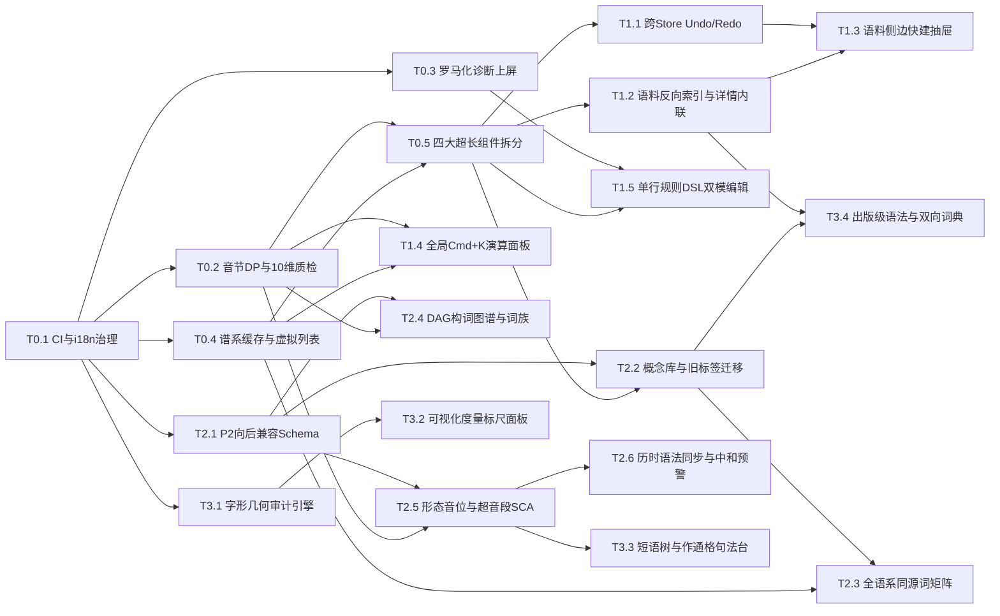

# Conlang Maker 核心产品力跃升 · 原子执行计划与对照总表（EXECUTION PLAN）

| 项目 | 内容 |
| --- | --- |
| 文档版本 | v1.0 |
| 日期 | 2026-11-12 |
| 需求依据 | [PRD.md](./PRD.md) v1.0、`.agents/rules/gemini.md` |
| 目标执行者 | 执行模型（如 DeepSeek v4.1 Flash）或开发者 |
| 终审复核者 | Antigravity（对照本计划与 [EXECUTION_LOG.md](./EXECUTION_LOG.md) 逐项审计） |

---

## 0. 执行者必读守则（动手写任何代码前必须逐条遵守）

### 0.1 十条铁律（违反任意一条均视为验收不通过）

1. **真实用户数据绝对只读**：严禁读取后修改或覆盖 `/Users/jrdamocles/code/TERRAX/` 下的任何文件；严禁将任何用户真实语料或词条提交进仓库。所有测试一律使用 `tests/fixtures/` 或内存合成数据。
2. **严格遵守 `.agents/rules/gemini.md`**：
   - **禁止 `any`**（含隐式 `any`、`as any`）；
   - **单个 React 组件文件严格 `≤ 300` 行**（可用 `wc -l` 自检，超过必须继续拆分）；
   - **禁止引入新的状态管理库或 CSS 框架**（本项目仅在 `T0.4` 允许安装无样式虚拟滚动 Hook `@tanstack/react-virtual`）；
   - UI 控件 class 必须引用 `src/lib/ui.ts` 中的常量；
   - 所有弹窗必须经 `src/components/common/ModalPortal.tsx` 挂载到 `document.body`；
   - 新增/删除用户可见文案必须**同时更新 `src/i18n/zh.ts` 与 `src/i18n/en.ts`**。
3. **`src/core/` 纯净性红线**：`src/core/` 下禁止出现 `react`、`@tauri-apps/*`、`window`/`document`/`localStorage`、`node:fs` 或 `console.log`。
4. **Rust 与存储向后兼容红线**：
   - Rust 生产代码禁止裸 `.unwrap()`（测试模块 `#[cfg(test)]` 除外），一律使用 `?` 传播 `Result<T, String>`；
   - `src-tauri/src/models.rs` 新增可选字段**必须**标注 `#[serde(default, skip_serializing_if = "Option::is_none")]` 或 `#[serde(default, skip_serializing_if = "Vec::is_empty")]`，新增 struct **必须**包含 `#[serde(default, flatten)] pub extra: ExtraFields;`，确保旧数据反序列化后再序列化与 `tests/golden/*.json` **逐字节一致**！
5. **GUI 与 MCP 工具契约同步**：若新增了 MCP 工具（`T1.2`、`T2.2`、`T2.3`、`T2.4`、`T2.6`、`T3.1`），**必须同步更新 `mcp/tests/expected-tools.ts` 的工具清单及 `mcp/tests/coverage-matrix.test.ts`**，否则 MCP 测试会直接失败。
6. **一任务一闭环一记录**：按任务 ID 顺序（或无依赖冲突的并行车道）逐个完成；每完成一个任务必须跑通 **§0.2 全量门禁命令 `V-ALL`**，并在 [EXECUTION_LOG.md](./EXECUTION_LOG.md) 勾选总表及填写该任务的完成记录。
7. **禁止顺手重构无关文件**，保持 git diff 聚焦在当前任务卡列出的目标文件范围内。

### 0.2 全量门禁验证命令（`V-ALL`）

每个任务宣称“完成”前，以下所有命令退出码必须全部为 `0`：

```bash
node scripts/i18n-check.mjs
node scripts/version-check.mjs
bun run core:check
bunx tsc --noEmit
bun test src
bun run mcp:check
bun run mcp:test
cargo test --manifest-path src-tauri/Cargo.toml
```

---

## 1. P0–P3 全景执行对照总表（Master Traceability Matrix）

> 说明：规模 `S` ≤ 2 小时，`M` = 半天~1 天，`L` = 1~2 天。车道：`E`=工程底座，`C`=核心纯引擎，`U`=前端交互，`S`=Rust/存储，`M`=MCP 同步。

| 任务 ID | 梯度 | 任务名称 | 对应 PRD | 前置依赖 | 车道 | 规模 | 核心新增 / 修改文件 | 关键验证目标 |
| :---: | :---: | :--- | :---: | :---: | :---: | :---: | :--- | :--- |
| **T0.1** | P0 | CI 全量门禁接入与僵尸翻译键清零 | §2.1 | — | E | S | `.github/workflows/ci.yml`、`src/i18n/{en,zh}.ts` | `i18n:check` 0 错误 0 未使用告警；CI 覆盖全部 8 条命令 |
| **T0.2** | P0 | DP+最大声母音节切分器与 10 维词典质检引擎 | §2.2 | T0.1 | C/M | M | 新建 `src/core/engines/syllabifier.{ts,test.ts}`；改 `qualityCheck.ts`、`QualityCheck.tsx` | 多字符 IPA 不被拆碎；`a.pa` 满足最大声母；10 项质检单测全绿 |
| **T0.3** | P0 | 罗马化静态诊断实时上屏 | §2.2 | T0.1 | U | S | 新建 `src/components/phonology/RomanizationLintBanner.tsx`；改 `RomanizationEditor.tsx` | 遮蔽死规则行内高亮；不可达与越界音素折叠提示 |
| **T0.4** | P0 | 谱系词库缓存层与动态高度虚拟列表接入 | §2.3 | T0.1 | U | M | 安装 `@tanstack/react-virtual`；新建 `src/store/lineageLexiconStore.ts`；改列表渲染 | 父词表不重复 IPC 拉取；万词滚动无固定高度重叠或跳动 |
| **T0.5** | P0 | 四大超长组件解耦拆分（回归 ≤300 行红线） | §2.3 | T0.2, T0.4 | U | M | 拆分 `Sidebar.tsx`、`EditorPane.tsx`、`RuleSetList.tsx`、`SCAPreview.tsx` 为 11 个子组件 | 4 个原文件与所有新子组件 `wc -l` 严格 `≤ 300` 行 |
| **T1.1** | P1 | 零依赖跨 Store 命令合并型 Undo/Redo 引擎 | §3.1 | T0.5 | U | M | 新建 `src/store/undoManager.{ts,test.ts}`；改 5 个业务 Store 与 `TitleBar.tsx` | 800ms 同键输入合并为 1 步；撤销后自动触发 500ms 防抖落盘 |
| **T1.2** | P1 | 语料反向索引引擎与词典详情三大内联卡片 | §3.2 | T0.5 | C/U/M | M | 新建 `src/core/engines/concordance.{ts,test.ts}`、3 个详情子卡片；MCP 加 `corpus_concordance` | 详情页可看例句出处、折叠屈折表、带语言名/IPA/本族字的演化链 |
| **T1.3** | P1 | 语料三行标注侧边快建词条抽屉 | §3.2 | T1.1, T1.2 | U | M | 新建 `src/components/corpus/CorpusQuickLexDrawer.tsx`；改 `GlossingEditor.tsx` | 点击未解析词原地建词并当场自动刷新当前句三行标注 |
| **T1.4** | P1 | 全局 `Cmd+K` 跨语系检索与即时沙盒演算面板 | §3.3 | T0.4, T0.2 | U | M | 新建 `src/components/common/CommandPalette.tsx`（替换/升级 `QuickEntry`） | 支持跨语系秒搜、`>` 导航、`= 词形` 即时回显 IPA/音节/字形/音变 |
| **T1.5** | P1 | 单行语言学规则 DSL ↔ 表单双向无损编辑器 | §3.4 | T0.3, T0.5 | C/U | M | 新建 `src/core/engines/ruleDsl.{ts,test.ts}`、`RuleDslEditor.tsx`；接入 3 处规则页 | 表单与 DSL 往返无损；非法语法精确报行列号且不污染 Store |
| **T2.1** | P2 | P2 向后兼容持久化 Schema 同步扩展 | §4.1–4.3 | T0.1 | S/C/M | M | 改 `src/types/index.ts`、`src-tauri/src/models.rs`、`mcp/storage/` | `cargo test` 黄金快照 `conformance` 零字节差异通过 |
| **T2.2** | P2 | CLDF/Concepticon 概念库、词义绑定与旧标签迁移 | §4.1 | T2.1, T0.5 | C/U/M | M | 新建 `src/data/core_concepts.ts`、`conceptMigration.ts`；改 `WordSensesSection`；加 MCP 工具 | 内置 Swadesh+LJ 核心概念；支持将 `概念:xxx` 标签无损迁入 `concept_id` |
| **T2.3** | P2 | 全语系同源词矩阵引擎与虚拟化对照表视图 | §4.1 | T2.2, T0.4 | C/U/M | L | 新建 `src/core/engines/cognateMatrix.{ts,test.ts}`、`CognateMatrixView.tsx`；加 MCP 工具 | 按同源根着色区分继承/借词/创新；点击空白格原地补词并绑概念 |
| **T2.4** | P2 | DAG 多词素构词图谱、词族树与过期复合词质检 | §4.2 | T2.1, T0.2 | C/U/M | M | 新建 `src/core/engines/wordFamily.{ts,test.ts}`、`WordFamilyPanel.tsx`；扩展 `qualityCheck` | 严防循环构词（DFS 环检测）；词根改音自动触发下游复合词过期提示 |
| **T2.5** | P2 | 共时形态音位层（`+` 边界）、多模式重音与超音段 SCA | §4.3 | T2.1, T0.2 | C/U | L | 新建 `src/core/engines/morphophonology.{ts,test.ts}`；改 `morphologyEngine`、`ipaGenerator`、`scaEngine` | 支持元音和谐词缀变体、倒数第二/音重敏感重音、`[-stressed]` 元音弱化 |
| **T2.6** | P2 | 历时语法词缀演化同步与同音中和（Syncretism）预警 | §4.4 | T2.5 | C/U/M | M | 新建 `src/core/workflows/grammarPullSync.{ts,test.ts}`、`GrammarSyncModal.tsx`；加 MCP 工具 | 自动演化 `sca_mutable` 词缀与不规则表，高亮不同格/时词缀合流警告 |
| **T3.1** | P3 | HarfBuzz WASM 字形几何与排版度量审计纯引擎 | §5.1 | T0.1 | C/M | M | 新建 `src/core/engines/fontGeometryAudit.{ts,test.ts}`；MCP 加 `font_audit_geometry` | 精确算出上下基线超调偏差、附标真实光学间距 `opticalGapX` 与笔画粗细 Q1 |
| **T3.2** | P3 | 书写系统可视化基准线叠加层与异常字形诊断面板 | §5.1 | T3.1 | U | M | 新建 `src/components/writing/GlyphGeometryInspector.tsx`；改 `GlyphPanel.tsx` | 单字与网格可开关 Ascender/x-height/Baseline/RSB 标尺并筛选参差字形 |
| **T3.3** | P3 | 递归短语结构树与格对齐（Nom-Acc / Erg-Abs）句法台 | §5.2 | T2.5 | C/U/M | L | 新建 `src/core/engines/phraseSandbox.{ts,test.ts}`；重构 `Sandbox.tsx`；扩展 `sandbox_translate` | 支持多修饰语归属、从句/介词短语嵌套及作通格自动论元标记 |
| **T3.4** | P3 | 出版级《参考语法与双向词典》单文件 HTML/矢量打印与 Typst 导出 | §5.3 | T1.2, T2.2 | C/U | L | 新建 `src/core/engines/referenceBookBuilder.{ts,test.ts}`；升级 `ExportImport.tsx` | 内嵌 Base64 字体完美呈现本族连字、CJK、IPA、三行标注与双向双栏词典 |

---

## 2. 依赖拓扑图（Mermaid）



---

## 3. P0 阶段原子任务卡（地基加固）

### T0.1 CI 全量门禁接入与僵尸翻译键清零
- **依赖**：无 ｜ **车道**：E ｜ **规模**：S
- **先读**：`.github/workflows/ci.yml`、`scripts/i18n-check.mjs`、`src/i18n/en.ts`、`src/i18n/zh.ts`、`src/components/phonology/ConsonantCharts.tsx`
- **实现要点**：
  1. 修改 `.github/workflows/ci.yml`：在 `Install frontend dependencies` 后依次加入 `bun run version:check`、`node scripts/i18n-check.mjs`、`bun run core:check`、`bunx tsc --noEmit`、`bun test src`、`bun run mcp:check`、`bun run mcp:test` 及 `cargo test --manifest-path src-tauri/Cargo.toml`。
  2. 排查 `node scripts/i18n-check.mjs` 列出的 139 个未使用 key：
     - 对于 `phonology.inventory.places.*`、`manners.*`、`presets.*` 等由模板字符串动态拼接访问的键，在对应组件中提取显式映射字典 `Record<..., string>`（满足 `gemini.md` 第 6 条“i18n key 尽可能保持显式引用”）；
     - 对于确无任何代码引用的历史残留键，从 `en.ts` 与 `zh.ts` 同步删除。
- **验收标准**：
  - [ ] `node scripts/i18n-check.mjs` 输出 `0 errors` 且未使用键警告数为 `0`（或仅剩显式注释说明的极少数保留键）。
  - [ ] `.github/workflows/ci.yml` YAML 语法合法且本地跑通 `V-ALL` 全部 8 条命令。

---

### T0.2 DP + 最大声母音节切分器与 10 维词典质检引擎
- **依赖**：T0.1 ｜ **车道**：C/M ｜ **规模**：M
- **先读**：`src/core/engines/wordGenerator.ts`、`src/core/engines/ipaGenerator.ts`、`src/core/engines/qualityCheck.ts`、`src/components/lexicon/QualityCheck.tsx`、`mcp/tools/lexicon.ts`
- **目标文件**：
  - 新建 `src/core/engines/syllabifier.ts`、`src/core/engines/syllabifier.test.ts`
  - 修改 `src/core/engines/index.ts`、`src/core/engines/qualityCheck.ts`、`src/components/lexicon/QualityCheck.tsx`、`src/i18n/{en,zh}.ts`
- **实现要点与防坑提示**：
  1. 在 `syllabifier.ts` 实现 `syllabify(phonemes: string[], phonotactics: Phonotactics, inventory: PhonemeInventory): SyllabificationResult`：
     - 复用并增强 `parseSyllableStructure` + `expandOptional`（同时支持 `(C)V(N)` 与 `C?VC?` 语法，注意防止超过 12 个可选组时的指数爆炸：直接将模板编译为槽位状态序列 `SlotSpec { allowed: Set<string>, optional: boolean, role: "onset" | "nucleus" | "coda" }[]` 做 DP，无需枚举 $2^k$ 字符串！）。
     - **防坑**：多字符音素（如 `tʃ`、`kʰ`、`aː`）已在 `phonemes: string[]` 中作为单个元素存在，DP 必须在 `string[]` 下标上推进，严禁 `.join("")` 后做字符级切分！
     - 多解消歧：优先最小化音节数；音节数相同时最大化相邻音节处右侧 `onset.length`（最大声母原则）。
  2. 在 `qualityCheck.ts` 中：
     - 将 `unmappedSpelling` 改为调用 `romanizationToPhonemesTraced(w.con_word_romanized, phonoConfig)`，若 `traced.romanization?.segments` 存在 `rule_id === null`（即未匹配任何规则的孤立字符，排除空格与已知标点），报 `unmappedSpelling`；
     - 新增 `phonotacticViolation`、`blacklistHit`、`vowelHarmonyViolation`、`homophonyClash` 四条规则，补齐中英双语翻译键并在 `QualityCheck.tsx` 支持按规则筛选开关。
- **验收标准**：
  - [ ] `syllabifier.test.ts` 覆盖：开音节最大声母（`["a","p","a"]` 在 `(C)V(C)` 下切分为 `[a].[pa]` 而非 `[ap].[a]`）、复辅音、多字符音素（`tʃ`、`aː`）、轻重音节判定、非法音丛定位。
  - [ ] `qualityCheck` 单测覆盖全部 10 类规则；MCP `lex_quality_check` 无需改签名即可自动透出新规则并保持 `mcp:test` 全绿。

---

### T0.3 罗马化静态诊断实时上屏
- **依赖**：T0.1 ｜ **车道**：U ｜ **规模**：S
- **先读**：`src/core/engines/romanizationLint.ts`、`src/components/phonology/RomanizationEditor.tsx`、`src/components/phonology/RuleTable.tsx`
- **目标文件**：
  - 新建 `src/components/phonology/RomanizationLintBanner.tsx`（`≤ 200` 行）
  - 修改 `src/components/phonology/RomanizationEditor.tsx`、`src/components/phonology/RuleTable.tsx`、`src/i18n/{en,zh}.ts`
- **实现要点**：
  - 用 `useMemo` 对当前默认映射表与音素表实时运行 `analyzeRomanization`；
  - 若全部健康显示精简绿色通过徽章；若存在死规则（`shadowed` / `duplicate`）、不可达音素（`unreachable_phonemes`）或越界音素（`unknown_phonemes`），顶部展示可展开诊断条，并在 `RuleTable.tsx` 对应 `rule_id` 行渲染黄色警示图标与原因提示。
- **验收标准**：
  - [ ] 所有涉及组件均 `≤ 300` 行；无硬编码文案；`V-ALL` 通过。

---

### T0.4 谱系词库缓存层与动态高度虚拟列表接入
- **依赖**：T0.1 ｜ **车道**：U ｜ **规模**：M
- **先读**：`src/components/lexicon/Sidebar.tsx`、`src/components/lexicon/EditorPane.tsx`、`src/components/sca/SCAPreview.tsx`、`src/utils/externalChanges.ts`
- **目标文件**：
  - 执行 `bun add @tanstack/react-virtual`
  - 新建 `src/store/lineageLexiconStore.ts`、`src/store/lineageLexiconStore.test.ts`
  - 修改 `Sidebar.tsx`、`EditorPane.tsx`、`SCAPreview.tsx`、`QualityCheck.tsx`
- **实现要点与防坑提示**：
  1. `lineageLexiconStore.ts` 按 `${projectPath}::${languagePath}` 缓存 `{ wordsById, phonoConfig, revision, loadingPromise }`，并发请求同一父语言时复用同一个 `loadingPromise` 去重；外部文件变更通知到来或切换工作区时精准失效缓存。
  2. 使用 `useVirtualizer` 改造词典侧边栏与 SCA 批量预览列表：
     - **严禁踩坑**：测量行外层 `div` 必须挂载 `ref={virtualizer.measureElement}` 与 `data-index={virtualRow.index}`，样式只写 `position: absolute; top: 0; left: 0; width: 100%; transform: translateY(${virtualRow.start}px)`——**绝对禁止在测量节点上写死 `height` 或 `margin-bottom`**（卡片间距统一用测量节点内部的 `pb-1.5` padding 实现）！
- **验收标准**：
  - [ ] 切换词条时不再重复触发 `load_all_words` IPC；
  - [ ] 合成 5,000 条不等高词条（部分含本族字+标签+IPA，部分仅单行）时列表无重叠、无底部截断；`V-ALL` 通过。

---

### T0.5 四大超长组件解耦拆分（回归 ≤300 行红线）
- **依赖**：T0.2、T0.4 ｜ **车道**：U ｜ **规模**：M
- **先读**：`src/components/lexicon/Sidebar.tsx`、`src/components/lexicon/EditorPane.tsx`、`src/components/sca/RuleSetList.tsx`、`src/components/sca/SCAPreview.tsx`
- **目标文件**：
  - `src/components/lexicon/`：拆出 `LexiconFilterBar.tsx`、`LexiconVirtualList.tsx`、`WordHeaderSection.tsx`、`WordSensesSection.tsx`、`WordEtymologySection.tsx`
  - `src/components/sca/`：拆出 `SCARuleCard.tsx`、`SCARuleEditorRow.tsx`、`SCASingleTester.tsx`、`SCABatchVirtualPreview.tsx`
- **验收标准**：
  - [ ] 运行 `wc -l src/components/lexicon/*.tsx src/components/sca/*.tsx`，**每一个文件行数严格 `≤ 300` 行**；
  - [ ] 原有交互、状态与快捷键行为 100% 保持不变；`V-ALL` 通过。

---

## 4. P1 阶段原子任务卡（高频交互闭环）

### T1.1 零依赖跨 Store 命令合并型 Undo/Redo 引擎
- **依赖**：T0.5 ｜ **车道**：U ｜ **规模**：M
- **先读**：`src/store/lexiconStore.ts`、`src/store/phonoStore.ts`、`src/store/grammarStore.ts`、`src/store/scaStore.ts`、`src/store/corpusStore.ts`、`src/components/nav/TitleBar.tsx`
- **目标文件**：
  - 新建 `src/store/undoManager.ts`、`src/store/undoManager.test.ts`
  - 修改上述 5 个业务 Store 与 `TitleBar.tsx`、`App.tsx`（绑定全局 `Cmd+Z` / `Ctrl+Z` 与 `Cmd+Shift+Z` / `Ctrl+Y`）
- **实现要点与防坑提示**：
  1. 严格按 PRD §3.1 实现 100 步环形历史栈与 `800ms` 同 `coalesceKey` 合并逻辑（打字连续修改同一词条的 `con_word_romanized` 时，前像固定为连击前的初始快照，后像实时更新）。
  2. **防死循环与防脱节**：各 Store 写方法增加可选参数 `opts?: { skipHistory?: boolean; coalesceKey?: string }`。当 `undo()` / `redo()` 执行时传入 `{ skipHistory: true }`，既不会把撤销动作重复压入撤销栈，又能**正常走通 Store 原有的 500ms 按实体 ID 防抖保存逻辑**，确保落盘一致！
  3. **焦点保护**：当 `document.activeElement` 为 `<input>` / `<textarea>` / `[contenteditable]` 时，若处于输入法组合态（`e.isComposing`）绝不拦截；顶栏增加撤销/重做图标按钮（带悬停操作名提示）。
- **验收标准**：
  - [ ] `undoManager.test.ts` 覆盖：推栈、撤销、重做、新操作截断 redo 分支、800ms 合并窗口、跨语言隔离、100 步容量淘汰；
  - [ ] 所有涉及组件 `≤ 300` 行；`V-ALL` 通过。

---

### T1.2 语料反向索引引擎与词典详情三大内联卡片
- **依赖**：T0.5 ｜ **车道**：C/U/M ｜ **规模**：M
- **先读**：`src/core/workflows/autoGloss.ts`、`src/store/corpusStore.ts`、`src/components/lexicon/EditorPane.tsx`、`mcp/tools/corpus.ts`、`mcp/tests/expected-tools.ts`
- **目标文件**：
  - 新建 `src/core/engines/concordance.ts`、`src/core/engines/concordance.test.ts`
  - 新建 `src/components/lexicon/WordConcordanceSection.tsx`、`src/components/lexicon/WordParadigmCollapsible.tsx`、`src/components/lexicon/EvolutionChainCards.tsx`
  - 修改 `EditorPane.tsx`、`mcp/tools/corpus.ts`、`mcp/tests/expected-tools.ts`、`src/i18n/{en,zh}.ts`
- **实现要点**：
  1. `findWordConcordance(entry, corpusTexts, grammar, phono)`：扫描语料各行 Token，匹配 ① Token 明确关联或词干匹配该词条，或 ② 表层归一化词形属于该词条基础形或已知屈折形集合；返回匹配句列表。
  2. 词典详情底部新增两个可折叠面板：**「屈折速览」**（调用 `generateParadigm` 渲染紧凑网格）与 **「语料例句出处（Concordance）」**（点击某句直接跳转 `/corpus` 并激活对应语料文章）。
  3. 将原演化路径文本升级为 `EvolutionChainCards.tsx`：横向展示每一代祖先语言的 `语言名 + 罗马字 + /IPA/ + <ScriptLine />`。
  4. 在 `mcp/tools/corpus.ts` 注册只读工具 `corpus_concordance`，**同步加入 `mcp/tests/expected-tools.ts`**。
- **验收标准**：
  - [ ] `concordance.test.ts` 覆盖原形命中、屈折变形命中、同形异义词区分与空语料边界；
  - [ ] MCP 工具总数与 `coverage-matrix.test.ts` 校验完全通过；所有组件 `≤ 300` 行。

---

### T1.3 语料三行标注侧边快建词条抽屉
- **依赖**：T1.1、T1.2 ｜ **车道**：U ｜ **规模**：M
- **先读**：`src/components/corpus/GlossingEditor.tsx`、`src/components/corpus/GlossTokenEdit.tsx`、`src/components/common/ModalPortal.tsx`
- **目标文件**：
  - 新建 `src/components/corpus/CorpusQuickLexDrawer.tsx`（`≤ 250` 行）
  - 修改 `GlossTokenEdit.tsx`、`GlossingEditor.tsx`、`src/i18n/{en,zh}.ts`
- **实现要点**：
  - 在三行标注点击未解析 Token（或编辑气泡中的“加入词典”按钮）时，通过 `ModalPortal` 打开右侧抽屉；
  - 自动填入当前 Token 归一化词形（若匹配某已知后缀，提示可选剥离词干），支持填写词性、释义、标签；
  - 点击保存后写入 `lexiconStore`，并立即针对当前行重跑 `autoGloss` 更新 Token 的 `morpheme_break` 与 `gloss_labels`。
- **验收标准**：
  - [ ] 无需离开 `/corpus` 页面即可完成生词入库与当前句自动重标；支持 `Cmd+Z` 撤销；组件均 `≤ 300` 行。

---

### T1.4 全局 `Cmd+K` 跨语系检索与即时沙盒演算面板
- **依赖**：T0.4、T0.2 ｜ **车道**：U ｜ **规模**：M
- **先读**：`src/components/common/QuickEntry.tsx`、`src/App.tsx`、`src/store/lineageLexiconStore.ts`
- **目标文件**：
  - 新建 `src/components/common/CommandPalette.tsx`、`src/components/common/CommandCalcPreview.tsx`
  - 修改 `src/App.tsx`、`src/components/nav/TitleBar.tsx`、`src/i18n/{en,zh}.ts`
- **实现要点**：
  - 全局监听 `Cmd+K` / `Ctrl+K`（经 `ModalPortal` 渲染，上下方向键选行、`Enter` 跳转、`Esc` 关闭）；
  - 普通输入：检索当前语言及 `lineageLexiconStore` 已加载语系词库（匹配罗马字前缀/子串、去斜杠 IPA、释义、标签）；
  - `>` 前缀：切换活跃语言、路由跳转、触发快建词条；
  - `=` 前缀（即时演算）：输入 `= bihar`，实时展示当前语言下的音素切分、音位/音值 IPA、DP 音节划分与音重、本族文字 `<ScriptLine />` 以及若有子语言时的 SCA 推演预览。
- **验收标准**：
  - [ ] 键盘纯盲操（`Cmd+K` → 输入 → `↑/↓` → `Enter` / `Esc`）流畅无焦点丢失；组件均 `≤ 300` 行。

---

### T1.5 单行语言学规则 DSL ↔ 表单双向无损编辑器
- **依赖**：T0.3、T0.5 ｜ **车道**：C/U ｜ **规模**：M
- **先读**：`src/core/engines/scaImportParser.ts`、`src/components/phonology/RomanizationEditor.tsx`、`src/components/phonology/AllophonyEditor.tsx`、`src/components/sca/SCARuleCard.tsx`
- **目标文件**：
  - 新建 `src/core/engines/ruleDsl.ts`、`src/core/engines/ruleDsl.test.ts`、`src/components/common/RuleDslEditor.tsx`
  - 修改 `RomanizationEditor.tsx`、`AllophonyEditor.tsx`、`SCARuleCard.tsx`、`src/i18n/{en,zh}.ts`
- **实现要点**：
  - 实现 `serializeRomanizationDsl` / `parseRomanizationDsl`、`serializeAllophonyDsl` / `parseAllophonyDsl`、`serializeScaRulesDsl` / `parseScaRulesDsl`；
  - 保留原有 `rule_id`（通过行号对齐或行尾可选 `@id:xxx` 元注释，避免每次切回表单把 `rule_id` 全洗掉导致引用断裂！）；
  - 语法错误返回结构化 `DslDiagnostic { line: number; message: string }[]`，UI 显示行号与错误浮层，未清零错误前禁用“应用到表单”。
- **验收标准**：
  - [ ] `ruleDsl.test.ts` 验证表单 → DSL → 表单往返 `deepEqual`（含空上下文、特征表达式 `[+voiced, -stop]`、`∅` 删除/插入、分隔符规则与 `rule_id` 保真）；`V-ALL` 通过。

---

## 5. P2 阶段原子任务卡（核心语言学模型深化）

### T2.1 P2 向后兼容持久化 Schema 同步扩展
- **依赖**：T0.1 ｜ **车道**：S/C/M ｜ **规模**：M
- **先读**：`src/types/index.ts`、`src-tauri/src/models.rs`、`src-tauri/tests/conformance.rs`、`mcp/storage/read.ts`、`mcp/tests/conformance.test.ts`
- **目标文件**：
  - 修改 `src/types/index.ts`、`src-tauri/src/models.rs`、`mcp/storage/` 相关读写类型映射
- **实现要点与防坑死命令**：
  1. 一次性把 PRD §4.1–§4.3 与 §5.2 定义的所有可选扩展字段同时在 TypeScript 与 Rust `models.rs` 对齐落地：
     - `WorkspaceConfig.custom_concepts?: ConceptDefinition[]`
     - `Sense.concept_id?: string`
     - `Etymology.components?: MorphemeComponent[]`、`Etymology.compounds_stale_digest?: string`
     - `Phonotactics.stress?: StressConfig | null`（兼容旧 `{ position: "initial", domain }` 并扩展 5 种 `StressPattern`）
     - `GrammarConfig.morphophonology_rules?: MorphophonologyRule[]`
     - `SyntaxConfig.alignment?: MorphosyntacticAlignment`
     - `SCARule` 超音段条件支持
  2. **黄金快照零回归铁律**：Rust 中所有新增 `Option<T>` 字段**必须**写 `#[serde(default, skip_serializing_if = "Option::is_none")]`，所有新增 `Vec<T>` 字段**必须**写 `#[serde(default, skip_serializing_if = "Vec::is_empty")]`，所有新增 struct **必须**带 `#[serde(default, flatten)] pub extra: ExtraFields;`！
- **验收标准**：
  - [ ] `cargo test --manifest-path src-tauri/Cargo.toml`（特别是 `conformance` 31 份黄金快照）**不改任何旧快照文件即 100% 原地通过**；
  - [ ] 新增包含上述新字段的新工作区往返序列化单测（Rust ↔ TS 字节一致）；`V-ALL` 通过。

---

### T2.2 CLDF / Concepticon 核心概念库、词义绑定与旧标签迁移
- **依赖**：T2.1、T0.5 ｜ **车道**：C/U/M ｜ **规模**：M
- **先读**：`src/core/engines/wordGenerator.ts`（现有 `SWADESH_100`）、`src/components/lexicon/WordSensesSection.tsx`、`mcp/tools/wordgen.ts`
- **目标文件**：
  - 新建 `src/data/core_concepts.ts`、`src/core/workflows/conceptMigration.ts`、`src/core/workflows/conceptMigration.test.ts`、`src/components/common/ConceptPicker.tsx`
  - 修改 `WordSensesSection.tsx`、`LexiconFilterBar.tsx`、`mcp/tools/lexicon.ts`（或新建 `mcp/tools/concepts.ts` 注册 `concept_list` / `concept_upsert`）、`mcp/tests/expected-tools.ts`
- **实现要点**：
  1. `core_concepts.ts` 收录合并去重后的 Swadesh-100 与 Leipzig-Jakarta 100 标准概念（含 `concept_id`、`gloss_zh`、`gloss_en`、`semantic_field`、`concepticon_id`、`standard_lists`）。
  2. 在词条义项编辑区提供轻量可搜索下拉 `ConceptPicker.tsx`（支持一键新建工作区自定义概念存入 `WorkspaceConfig.custom_concepts`）。
  3. `conceptMigration.ts`：扫描词条 `metadata.tags` 中形如 `概念:xxx`、`概念\d+`、`concept:xxx` 的标签，生成 `dryRun` 映射预览，用户确认后自动创建/关联 `concept_id` 并可选清理冗余标签。
- **验收标准**：
  - [ ] 概念检索支持中英文、ID 与语义域过滤；迁移纯函数单测覆盖幂等性与冲突合并；MCP 测试全绿。

---

### T2.3 全语系同源词矩阵引擎与虚拟化对照表视图
- **依赖**：T2.2、T0.4 ｜ **车道**：C/U/M ｜ **规模**：L
- **先读**：`src/pages/FamilyTree.tsx`、`src/store/lineageLexiconStore.ts`、`src/core/engines/wordLifecycle.ts`
- **目标文件**：
  - 新建 `src/core/engines/cognateMatrix.ts`、`src/core/engines/cognateMatrix.test.ts`
  - 新建 `src/components/tree/CognateMatrixView.tsx`、`src/components/tree/CognateCellPopover.tsx`
  - 修改 `FamilyTree.tsx`（或新增路由标签页 `/cognates`）、注册 MCP 工具 `family_cognate_matrix` 并更新 `expected-tools.ts`
- **实现要点**：
  1. `buildCognateMatrix(languages, wordsByLanguage, concepts)`：
     - 沿 `parent_entry_id` 向上追溯每个词条的最终祖语词根 ID（`cognate_set_id`）；
     - 同一概念行内，共享同一 `cognate_set_id` 的单元格分配同色系徽章（直观看出哪几支保留了同源词、哪支借词 `borrowed`、哪支独立创新）。
  2. 前端表格纵向采用 `useVirtualizer` 虚拟滚动；首列（概念名）固定 `sticky left-0`；点击空白单元格可直接输入罗马字在对应语言中新建词条并自动绑定该 `concept_id`。
- **验收标准**：
  - [ ] 140+ 概念 × 8 门子语言矩阵滚动流畅，同源集归组在多代分支与借词场景下 100% 准确；所有组件 `≤ 300` 行。

---

### T2.4 DAG 多词素构词图谱、词族树与过期复合词质检
- **依赖**：T2.1、T0.2 ｜ **车道**：C/U/M ｜ **规模**：M
- **先读**：`src/core/engines/derivationEngine.ts`、`src/core/engines/qualityCheck.ts`、`src/components/lexicon/WordEtymologySection.tsx`
- **目标文件**：
  - 新建 `src/core/engines/wordFamily.ts`、`src/core/engines/wordFamily.test.ts`、`src/components/lexicon/WordFamilyPanel.tsx`
  - 修改 `WordEtymologySection.tsx`、`qualityCheck.ts`、注册 MCP `lex_word_family` 并更新 `expected-tools.ts`
- **实现要点**：
  1. `wordFamily.ts` 实现：① `wouldIntroduceCycle(entryId, targetComponentId, wordsMap)`（DFS 环检测）、② `computeComponentsDigest(components, wordsMap)`、③ `getWordFamilyGraph(entryId, wordsMap)`（返回上游构成词根树与下游全部派生/复合子孙词列表）。
  2. 在 `WordEtymologySection` 支持为 `derived` / 复合词点选添加多个词素成分（如 `[日] + [月] → 明`），并内联渲染 `WordFamilyPanel`（点击任一同根词直接跳转该词条）。
  3. `qualityCheck.ts` 增加 `staleCompound` 规则：当上游词根读音摘要变化导致与 `compounds_stale_digest` 不一致时给出 `warning`。
- **验收标准**：
  - [ ] 自指（`A -> A`）与间接环（`A -> B -> C -> A`）在引擎层被 100% 拦截并有单测覆盖；`V-ALL` 通过。

---

### T2.5 共时形态音位层（`+` 边界）、多模式重音与超音段 SCA
- **依赖**：T2.1、T0.2 ｜ **车道**：C/U ｜ **规模**：L
- **先读**：`src/core/engines/morphologyEngine.ts`、`src/core/engines/ipaGenerator.ts`、`src/core/engines/scaEngine.ts`、`src/core/engines/syllabifier.ts`
- **目标文件**：
  - 新建 `src/core/engines/morphophonology.ts`、`src/core/engines/morphophonology.test.ts`、`src/components/grammar/MorphophonologySection.tsx`
  - 修改 `morphologyEngine.ts`、`ipaGenerator.ts`、`scaEngine.ts`、`PhonotacticsSections.tsx`、`GrammarPage.tsx`
- **实现要点**：
  1. **形态音位管线**：`morphologyEngine` 拼接词缀时生成带 `+` 边界的中间串（如 `ev+lar`），调用 `applyMorphophonology(intermediate, grammar.morphophonology_rules, phonoConfig)` 完成跨边界同化/元音和谐（如 `ev+lar → ev+ler`），随后去除 `+` 输出最终表层词形。
  2. **多模式重音**：在 `ipaGenerator.ts` 调用 `syllabify()`，支持 `initial`、`ultimate`、`penultimate`、`antepenultimate` 与 `weight_sensitive`（重音节优先，全轻音节按 `weight_fallback` 回退），精确插入主重音 `ˈ`。
  3. **超音段感知 SCA**：在 `scaEngine.ts` 运行每条规则前计算当前词的音节与重音分布，向每个音素动态注入伪特征 `+stressed`/`-stressed`、`+open_syllable`/`+closed_syllable`、`+initial_syllable`/`+final_syllable`，使特征表达式 `[+vowel, -stressed] > ə` 原生生效！
- **验收标准**：
  - [ ] 单测完整验证：土耳其式后缀元音和谐、拉丁式倒数第二音节音重敏感重音、非重读音节元音弱化为 `ə`、闭音节长元音缩短；原有旧测试 100% 不破。

---

### T2.6 历时语法词缀演化同步与同音中和（Syncretism）预警
- **依赖**：T2.5 ｜ **车道**：C/U/M ｜ **规模**：M
- **先读**：`src/core/workflows/pullSync.ts`、`src/components/tree/PullSync.tsx`、`src/types/index.ts`
- **目标文件**：
  - 新建 `src/core/workflows/grammarPullSync.ts`、`src/core/workflows/grammarPullSync.test.ts`、`src/components/tree/GrammarSyncModal.tsx`
  - 修改 `PullSync.tsx`（或谱系节点菜单）、注册 MCP `gram_pull_sync` 并更新 `expected-tools.ts`
- **实现要点**：
  - 提取父语言 `sca_mutable !== false` 的屈折规则词缀、派生词缀与不规则覆盖词形，运行子语言 `scaConfig`；
  - 检测同一 `pos_id` 下原本不同表层的两条屈折规则在音变后是否产出完全相同的词缀与环境——若是，标记 `syncretismCollisions` 高亮警告；
  - 支持勾选要同步的规则，在事务快照保护下写入子语言 `grammar.json`。
- **验收标准**：
  - [ ] 单测覆盖常规词缀音变、锁定的 `sca_mutable: false` 跳过逻辑及格标记合流（Syncretism）检测；弹窗严格走 `ModalPortal`。

---

## 6. P3 阶段原子任务卡（专业深水区与出版闭环）

### T3.1 HarfBuzz WASM 字形几何与排版度量审计纯引擎
- **依赖**：T0.1 ｜ **车道**：C/M ｜ **规模**：M
- **先读**：`mcp/font/loader.ts`、`mcp/font/shaper.ts`、`node_modules/harfbuzzjs/dist/index.d.mts`、`src/core/engines/coverage.ts`
- **目标文件**：
  - 新建 `src/core/engines/fontGeometryAudit.ts`、`src/core/engines/fontGeometryAudit.test.ts`
  - 修改 `mcp/font/`（导出轮廓点提取辅助）、`mcp/tools/audit.ts`（注册 `font_audit_geometry`）、`mcp/tests/expected-tools.ts`
- **实现要点**：
  - `fontGeometryAudit.ts` 保持纯计算（接收结构化字形轮廓 `GlyphOutlineInput { gid, name, codepoints, advanceWidth, commands: SvgPathCommand[] }[]` 与字体度量 `upm, ascender, descender, capHeight, xHeight`）；
  - 精确对二次/三次贝塞尔曲线采样：
    1. 计算基础字形 `yMax` 与剔除深降部后的主干底边 `yMin` 相对中位数的超调偏差，标记异常字形；
    2. 对含附标的组合字形或 `base + mark` 对，计算附标高度带内的真实右侧轮廓净距 `opticalGapX` 及离散度（标准差与极值）；
    3. 40 条水平/垂直扫描线求笔画弦长 `Q1` 估算字重均匀度。
- **验收标准**：
  - [ ] 单测使用合成字形路径验证：高低参差底座检出、附标光学悬空检出、笔画过细检出；MCP `font_audit_geometry` 端到端测试通过。

---

### T3.2 书写系统可视化基准线叠加层与异常字形诊断面板
- **依赖**：T3.1 ｜ **车道**：U ｜ **规模**：M
- **先读**：`src/pages/WritingPage.tsx`、`src/components/writing/GlyphPanel.tsx`、`src/components/writing/GlyphGridSection.tsx`
- **目标文件**：
  - 新建 `src/components/writing/GlyphGeometryInspector.tsx`（`≤ 260` 行）
  - 修改 `GlyphPanel.tsx`、`GlyphGridSection.tsx`、`src/i18n/{en,zh}.ts`
- **实现要点**：
  - 在字形网格与单字检视器提供“显示排版标尺”开关（叠加 SVG 水平线：`Ascender`、`CapHeight`/`x-height`、`Baseline y=0`、`Descender` 以及左右 `LSB/RSB` 虚线）；
  - 一键展示 `fontGeometryAudit` 体检摘要卡片，点击“上缘偏低 / 基线悬空 / 附标过远”筛选项即可在字形表中高亮对应字形。
- **验收标准**：
  - [ ] 无字体加载时优雅降级隐藏；所有涉及组件 `≤ 300` 行；`V-ALL` 通过。

---

### T3.3 递归短语结构树与格对齐（Nom-Acc / Erg-Abs）句法台
- **依赖**：T2.5 ｜ **车道**：C/U/M ｜ **规模**：L
- **先读**：`src/core/engines/sandbox.ts`、`src/components/sandbox/Sandbox.tsx`、`src/components/grammar/SyntaxSection.tsx`、`mcp/tools/grammar_sandbox.ts`
- **目标文件**：
  - 新建 `src/core/engines/phraseSandbox.ts`、`src/core/engines/phraseSandbox.test.ts`
  - 新建 `src/components/sandbox/ClauseBuilderCard.tsx`、`src/components/sandbox/NPBuilderRow.tsx`
  - 修改 `SyntaxSection.tsx`（增加格对齐 `alignment` 选择）、`Sandbox.tsx`（≤ 300 行）、`mcp/tools/grammar_sandbox.ts`
- **实现要点**：
  - 严格按 PRD §5.2 实现三阶段线性化（论元格对齐分配 → 核心/依附一致关系传播 → 递归语序展开 + 形态音位渲染）；
  - 修复旧版 `sandbox.ts` 多个修饰语全部串绑到宾语 `O` 的历史 Bug：每个 `NPNode` 独立持有自身的限定词、数词、形容词与属格领属者；
  - UI 提供直观的结构化构建器（主语 NP / 动词 TAM / 宾语 NP / 斜格介词短语 PP）与结果卡片（本族文字句 + IPA + 标准 Leipzig 三行对齐块 + 规则推导步骤树）。
- **验收标准**：
  - [ ] `phraseSandbox.test.ts` 覆盖：SVO/SOV/VSO × 前置/后置修饰语 × 主宾格（不及物 S=NOM，及物 A=NOM, P=ACC）vs 作通格（不及物 S=ABS，及物 A=ERG, P=ABS）全组合正确；所有组件 `≤ 300` 行。

---

### T3.4 出版级《参考语法与双向词典》单文件 HTML/矢量打印与 Typst 导出
- **依赖**：T1.2、T2.2 ｜ **车道**：C/U ｜ **规模**：L
- **先读**：`src/utils/exportPDF.ts`、`src/pages/ExportImport.tsx`、`src/core/engines/llmPrompt.ts`
- **目标文件**：
  - 新建 `src/core/engines/referenceBookBuilder.ts`、`src/core/engines/referenceBookBuilder.test.ts`、`src/components/export/ReferenceBookModal.tsx`
  - 修改 `src/pages/ExportImport.tsx`（控制在 `≤ 300` 行，必要时拆分子组件）、`src/i18n/{en,zh}.ts`
- **实现要点**：
  1. `buildReferenceBookHtml(options)`（纯字符串构建，100% 位于 `src/core/`）：
     - 若传入本族字体 Base64，自动注入 `@font-face` 与 `font-feature-settings`；
     - 排版包含：封面、自动章节目录、音系矩阵与罗马化表、语法类型学与自动生成的屈折范式表、语法手册章节（自动解析 `{{paradigm:...}}` 内嵌宏）、Leipzig 对齐语料选集、**Part I: Conlang → 释义词典（双栏）** 与 **Part II: 释义/概念 → Conlang 反向索引（双栏）**；
     - 严格对所有用户输入做 HTML 转义（防 XSS 注入）。
  2. `buildReferenceBookTypst(options)`：同步输出结构干净的 `.typ` Typst 源码文本。
  3. 前端提供章节勾选、实时 iframe 预览、“导出独立 HTML 专著”与“调用系统打印生成矢量 PDF”按钮。
- **验收标准**：
  - [ ] 包含中文、复杂 IPA（`tʃʰ, ˈ, ː, ə`）、本族文字连字与三行标注时零乱码；HTML 特殊字符（`< > & "`）转义测试通过；`ExportImport.tsx` 及子组件全部 `≤ 300` 行；全仓最终 `V-ALL` 全绿。


---

## 7. DeepSeek 零推理防坑实现蓝图（Copy-Ready Implementation Blueprints）

> **致执行模型（DeepSeek v4.1 Flash）**：本节已将所有涉及算法设计、序列化兼容、跨端 WASM 加载、组件状态边界的核心决策**全部具象化为可直接落地的代码骨架**。执行对应任务时**直接照搬以下结构与公式，严禁自行发明替代方案**。

---

### 7.1 `T0.2` DP + 最大声母音节切分器精确骨架（`src/core/engines/syllabifier.ts`）

```ts
import type { PhonemeInventory, Phonotactics } from "../../types";

export interface ParsedSyllable {
  onset: string[];
  nucleus: string[];
  coda: string[];
  weight: "light" | "heavy";
}

export interface SyllabificationResult {
  valid: boolean;
  syllables: ParsedSyllable[];
  failedAtTokenIndex?: number;
}

interface SlotUnit {
  allowed: Set<string>;
  optional: boolean;
}

/**
 * 1. 编译模板（避免 2^k 展开指数爆炸）：
 *    支持 "(C)(L)V(N)" 与 "C?VC?" 两种可选语法。
 *    默认宏回退：若 macros 未定义 "C"，自动取 inventory.consonants；未定义 "V"，自动取 inventory.vowels。
 */
export function compileSyllableUnits(
  structure: string,
  macros: Record<string, string[]>,
  inventory: PhonemeInventory,
): SlotUnit[] {
  const effectiveMacros: Record<string, Set<string>> = {
    C: new Set(inventory.consonants),
    V: new Set(inventory.vowels),
  };
  for (const [k, arr] of Object.entries(macros)) {
    effectiveMacros[k] = new Set(arr);
  }

  const units: SlotUnit[] = [];
  const s = structure.trim();
  let i = 0;
  while (i < s.length) {
    const ch = s[i]!;
    if (ch === " " || ch === "\t") {
      i += 1;
      continue;
    }
    if (ch === "(") {
      const close = s.indexOf(")", i + 1);
      if (close > i + 1) {
        const inner = s.slice(i + 1, close).trim();
        // 支持括号内单槽位如 (C) 或多槽位顺序展开：若含多个符号，逐个标为 optional
        for (const sym of [...inner]) {
          const set = effectiveMacros[sym] ?? new Set([sym]);
          units.push({ allowed: set, optional: true });
        }
        i = close + 1;
        continue;
      }
    }
    const nextIsQ = s[i + 1] === "?";
    const set = effectiveMacros[ch] ?? new Set([ch]);
    units.push({ allowed: set, optional: nextIsQ });
    i += nextIsQ ? 2 : 1;
  }
  return units;
}

/**
 * 2. 最优解比较器（核心！决定音节边界消歧）：
 *    规则 A：总音节数更少者胜出；
 *    规则 B（Maximal Onset Principle）：音节数相同时，从第 2 个音节（k=1）起从左向右比较，
 *           首个 onset.length 不同的位置，onset.length 更大者胜出（例如 a.pa 优于 ap.a）。
 */
function isBetterPlan(cand: ParsedSyllable[], best: ParsedSyllable[] | null): boolean {
  if (!best) return true;
  if (cand.length !== best.length) return cand.length < best.length;
  for (let k = 1; k < cand.length; k += 1) {
    const diff = cand[k]!.onset.length - best[k]!.onset.length;
    if (diff !== 0) return diff > 0;
  }
  return false;
}

/**
 * 3. 单音节内部切分与音重判定：
 *    给定匹配到的 token 切片 tokens[start..end]，找到第一段连续属于 vowelSet 的元素作为 nucleus：
 *    - 若模板要求元音但切片内无元音，判为非法单音节（返回 null）；
 *    - onset = 核前全部辅音；coda = 核后全部音素；
 *    - weight = (coda.length > 0 || nucleus.length > 1 || nucleus.some(p => p.includes("ː"))) ? "heavy" : "light"
 */
```
- **DP 状态转移**：设 `dp: (ParsedSyllable[] | null)[] = Array(N + 1).fill(null)`，`dp[0] = []`。对 `i = 0 .. N-1`，若 `dp[i] === null` 跳过；用递归小函数在 `units` 上从 `(unitIdx = 0, tokIdx = i)` 向右枚举所有合法终点 `endIdx > i`，构造 `syl = buildParsedSyllable(tokens.slice(i, endIdx), vowelSet)`，若合法且 `isBetterPlan([...dp[i], syl], dp[endIdx])`，更新 `dp[endIdx]`。若最终 `dp[N] === null`，取最大的满足 `dp[k] !== null` 的下标 `k` 作为 `failedAtTokenIndex: k` 返回 `{ valid: false, syllables: [], failedAtTokenIndex: k }`。

---

### 7.2 `T0.4` 动态高度虚拟列表标准模板与 `T0.5` 组件拆分 Props 边界表

#### A. `@tanstack/react-virtual` 唯一合法 JSX 结构（严禁改写测量节点样式）
```tsx
const parentRef = useRef<HTMLDivElement | null>(null);
const virtualizer = useVirtualizer({
  count: items.length,
  getScrollElement: () => parentRef.current,
  estimateSize: () => 68,
  overscan: 8,
});

return (
  <div ref={parentRef} className="flex-1 overflow-y-auto contain-strict">
    <div style={{ height: `${virtualizer.getTotalSize()}px`, width: "100%", position: "relative" }}>
      {virtualizer.getVirtualItems().map((vRow) => {
        const item = items[vRow.index]!;
        return (
          <div
            key={item.entry_id}
            data-index={vRow.index}
            ref={virtualizer.measureElement}
            style={{
              position: "absolute",
              top: 0,
              left: 0,
              width: "100%",
              transform: `translateY(${vRow.start}px)`,
            }}
          >
            {/* 间距只能写在内层包装容器的 pb-* 上，严禁在外层写 margin 或固定 height！ */}
            <div className="pb-1.5 px-2">{renderRow(item)}</div>
          </div>
        );
      })}
    </div>
  </div>
);
```

#### B. `T0.5` 四大超长组件精确职责与状态归属表
| 原组件 | 拆分后子文件（均须 `≤ 300` 行） | 父组件保留状态 | 子组件纯 Props 输入/回调 |
| :--- | :--- | :--- | :--- |
| `Sidebar.tsx` | `LexiconFilterBar.tsx`、`LexiconVirtualList.tsx` | 搜索词、IPA 模式、词性/标签/变更状态筛选、批量勾选 `selectedIds` | `FilterBar` 接收筛选值与 `onChange`；`VirtualList` 接收过滤排序后的 `entries`、`changeMap`、`activeId`、`onSelect` |
| `EditorPane.tsx` | `WordHeaderSection.tsx`、`WordSensesSection.tsx`、`WordEtymologySection.tsx` | 当前 `entry` 派生计算（IPA trace、父语言映射）与写回 `upsertWord` 封装 | 各 Section 接收 `entry` 切片与 `onPatchEntry(partial, coalesceKey)`，不直接操作路由 |
| `RuleSetList.tsx` | `SCARuleCard.tsx`、`SCARuleEditorRow.tsx` | 展开折叠的 `rulesetId` 集合、拖拽/上下移动排序处理 | `SCARuleCard` 管单个规则集头与 DSL/表单切换；`SCARuleEditorRow` 管单条规则字段编辑 |
| `SCAPreview.tsx` | `SCASingleTester.tsx`、`SCABatchVirtualPreview.tsx` | 单测输入词本地 `useState`、筛选仅看已变化开关 | `SingleTester` 负责单词逐步规则日志；`BatchVirtualPreview` 负责全词表虚拟列表 |

---

### 7.3 `T1.1` 零依赖 `undoManager.ts` 完整核心骨架与 Store 接入契约

```ts
// src/store/undoManager.ts — 不使用 Zustand，纯模块级环形栈 + useSyncExternalStore 订阅
import { useSyncExternalStore } from "react";

export type UndoDomain = "lexicon" | "phonology" | "grammar" | "sca" | "corpus";

export interface HistoryOpts {
  skipHistory?: boolean;
  coalesceKey?: string;
  labelKey?: string;
}

export interface UndoEntry {
  id: string;
  languageId: string;
  domain: UndoDomain;
  labelKey: string;
  coalesceKey?: string;
  timestamp: number;
  undo: () => void | Promise<void>;
  redo: () => void | Promise<void>;
}

const MAX_HISTORY = 100;
const COALESCE_MS = 800;

let undoStack: UndoEntry[] = [];
let redoStack: UndoEntry[] = [];
const listeners = new Set<() => void>();

function emit(): void {
  for (const fn of listeners) fn();
}

export function pushUndoEntry(entry: Omit<UndoEntry, "id" | "timestamp"> & { timestamp?: number }): void {
  const now = entry.timestamp ?? Date.now();
  const top = undoStack[undoStack.length - 1];
  if (
    top &&
    entry.coalesceKey &&
    top.coalesceKey === entry.coalesceKey &&
    top.languageId === entry.languageId &&
    now - top.timestamp <= COALESCE_MS
  ) {
    // 保留 top.undo（最初前像），仅更新 redo 与时间戳！
    undoStack[undoStack.length - 1] = { ...top, redo: entry.redo, timestamp: now };
    redoStack = [];
    emit();
    return;
  }
  undoStack = [...undoStack.slice(-(MAX_HISTORY - 1)), { ...entry, id: crypto.randomUUID(), timestamp: now }];
  redoStack = [];
  emit();
}

export async function performUndo(activeLanguageId?: string): Promise<UndoEntry | null> {
  const idx = activeLanguageId
    ? undoStack.findLastIndex((e) => e.languageId === activeLanguageId)
    : undoStack.length - 1;
  if (idx < 0) return null;
  const target = undoStack[idx]!;
  undoStack = [...undoStack.slice(0, idx), ...undoStack.slice(idx + 1)];
  await target.undo();
  redoStack = [...redoStack, target];
  emit();
  return target;
}
```
- **防引用污染死命令**：在 5 个业务 Store 记录 `undo` / `redo` 闭包前，**必须使用 `const prevSnapshot = structuredClone(prevObj)` 和 `const nextSnapshot = structuredClone(nextObj)` 深拷贝快照**！严禁直接捕获可变引用。
- **落盘同步死命令**：`undo` 闭包内部调用 `useLexiconStore.getState().upsertWord(prevSnapshot, { skipHistory: true })`（其余 4 个 Store 同理），这样既跳过再次入栈，又自动触发 Store 原有的 `500ms` 按实体 ID 防抖落盘。

---

### 7.4 `T1.5` 单行语言学规则 DSL 精确语法规范（`src/core/engines/ruleDsl.ts`）

所有三类规则统一使用按行解析（空行或纯 `#` 开头注释行忽略；替换箭头同时兼容 `->`、`>`、`→`；空串用 `∅` 序列化，解析时同时接受 `∅` 与 `0`）：

1. **罗马化规则（`RomanizationRule`）**：
   - 标准序列化格式：
     - 普通音素规则：`sh -> ʃ / _ i  @id:rule_01`（若前后环境均为空，省略 `/ ...` 段：`sh -> ʃ  @id:rule_01`）
     - 分隔符规则：`-> [sep]`（例：`'- -> [sep]  @id:rule_sep`）
2. **音位变体规则（`AllophonyRule`）**：
   - 标准序列化格式：`t -> d / V _ V  # 元音间浊化  @id:allo_01`
   - `priority` 按行号从 `1` 开始自动递增重排。
3. **历时音变规则（`SCARule`）**：
   - 字符模式：`p t k -> b d g / V _ V  ! pt, kt  # 浊化  @id:sca_01`（`!` 后为逗号分隔 `exceptions`，无例外则省略）
   - 特征模式：`[+stop, -voiced] -> [+voiced] / [+vowel] _ [+vowel]  # 特征浊化  @id:sca_02`
     - 当左侧以 `[` 开头且内含 `+` 或 `-` 特征项时，自动判定 `feature_mode = true`，解析为 `FeatureExpression { positive, negative }` 与 `FeatureReplacement { set_features, remove_features }`。
4. **`@id:<rule_id>` 保真机制**：序列化时在行尾附带 `@id:<rule_id>`；用户在文本域复制或手写新行未写 `@id:` 时，自动调用 `crypto.randomUUID()`（或确定性前缀 ID）分配新 `rule_id`，确保已有规则 ID 100% 不丢失。

---

### 7.5 `T2.1` Rust `models.rs` 与 `mcp/storage/read.ts` 字节级兼容代码清单

#### A. **最高优先级陷阱警告：`Phonotactics.stress` 的处理**
- 在现有 `src-tauri/src/models.rs` 中，`Phonotactics` **原本就没有定义 `pub stress` 字段**，它一直通过 `#[serde(default, flatten)] pub extra: ExtraFields` 无损透传（无论磁盘上是省略、`"stress": null` 还是对象）。
- **死命令**：在 `T2.1` 中，**只扩展 TypeScript `src/types/index.ts` 中的 `StressConfig` 类型，绝对禁止在 Rust `models.rs` 的 `Phonotactics` 结构体上新增 `pub stress` 字段**！继续由 `extra: ExtraFields` 原样透传，即可 100% 保证省略/`null`/对象三种形态字节零差异！

#### B. Rust `src-tauri/src/models.rs` 精确新增代码模板
```rust
#[derive(Debug, Serialize, Deserialize, Clone, Default, PartialEq)]
pub struct ConceptDefinition {
    #[serde(default)]
    pub concept_id: String,
    #[serde(default)]
    pub gloss_en: String,
    #[serde(default)]
    pub gloss_zh: String,
    #[serde(default)]
    pub semantic_field: String,
    #[serde(default, skip_serializing_if = "Option::is_none")]
    pub concepticon_id: Option<String>,
    #[serde(default, skip_serializing_if = "Vec::is_empty")]
    pub standard_lists: Vec<String>,
    #[serde(default, flatten)]
    pub extra: ExtraFields,
}

#[derive(Debug, Serialize, Deserialize, Clone, Default, PartialEq)]
pub struct MorphemeComponent {
    #[serde(default, skip_serializing_if = "Option::is_none")]
    pub entry_id: Option<String>,
    #[serde(default, skip_serializing_if = "Option::is_none")]
    pub derivation_rule_id: Option<String>,
    #[serde(default, skip_serializing_if = "Option::is_none")]
    pub surface_override: Option<String>,
    #[serde(default)]
    pub relation: String,
    #[serde(default, flatten)]
    pub extra: ExtraFields,
}

#[derive(Debug, Serialize, Deserialize, Clone, Default, PartialEq)]
pub struct MorphophonologyRule {
    #[serde(default)]
    pub rule_id: String,
    #[serde(default)]
    pub description: String,
    #[serde(default, skip_serializing_if = "Option::is_none")]
    pub disabled: Option<bool>,
    #[serde(default)]
    pub priority: u32,
    #[serde(default)]
    pub target: String,
    #[serde(default)]
    pub replacement: String,
    #[serde(default)]
    pub context_before: String,
    #[serde(default)]
    pub context_after: String,
    #[serde(default)]
    pub feature_mode: bool,
    #[serde(default)]
    pub target_features: Option<FeatureExpression>,
    #[serde(default)]
    pub replacement_features: Option<FeatureReplacement>,
    #[serde(default)]
    pub context_before_features: Option<FeatureExpression>,
    #[serde(default)]
    pub context_after_features: Option<FeatureExpression>,
    #[serde(default, flatten)]
    pub extra: ExtraFields,
}
```
各既有结构体新增字段**必须一字不差使用以下属性**：
- `WorkspaceConfig`：`#[serde(default, skip_serializing_if = "Vec::is_empty")] pub custom_concepts: Vec<ConceptDefinition>,`
- `Sense`：`#[serde(default, skip_serializing_if = "Option::is_none")] pub concept_id: Option<String>,`
- `Etymology`：
  - `#[serde(default, skip_serializing_if = "Vec::is_empty")] pub components: Vec<MorphemeComponent>,`
  - `#[serde(default, skip_serializing_if = "Option::is_none")] pub compounds_stale_digest: Option<String>,`
- `GrammarConfig`：`#[serde(default, skip_serializing_if = "Vec::is_empty")] pub morphophonology_rules: Vec<MorphophonologyRule>,`
- `SyntaxConfig`：
  - `#[serde(default, skip_serializing_if = "Option::is_none")] pub alignment: Option<String>,`
  - `case_gloss_map` 保持经 `extra: ExtraFields` 透传或 `#[serde(default, skip_serializing_if = "Option::is_none")]`。

#### C. `mcp/storage/read.ts` 对齐清理规则
在 `normalizeWordEntryFromRaw` 中（紧跟 `grammatical_function` 清理逻辑）：
- 对 `Sense`：`if (copy.concept_id === null || copy.concept_id === undefined) delete copy.concept_id;`
- 对 `Etymology`：若 `!Array.isArray(rawEtym.components) || rawEtym.components.length === 0`，`delete etymCopy.components`；若 `rawEtym.compounds_stale_digest == null`，`delete etymCopy.compounds_stale_digest`。
- 对 `WorkspaceConfig` 与 `GrammarConfig`：同样当 `custom_concepts` / `morphophonology_rules` 为空数组或未定义时不注入空数组键，与 Rust `skip_serializing_if = "Vec::is_empty"` 保持 100% 字节一致！

---

### 7.6 MCP 新增工具接线与 `coverage-matrix.test.ts` 必改点

1. **修复硬编码工具数断言（首次在 `T1.2` 新增工具时一并修改）**：
   打开 `mcp/tests/coverage-matrix.test.ts`：
   - 将第 34 行的 `expect(EXPECTED_76_TOOLS.length).toBe(76);` 改为 `expect(EXPECTED_76_TOOLS.length).toBeGreaterThanOrEqual(76);`
   - 将第 57 行的 `expect(tools.length).toBe(76);` 改为 `expect(tools.length).toBe(EXPECTED_76_TOOLS.length);`
2. **每新增一个工具的标准三步曲**：
   - 步骤 1：在 `mcp/tools/<module>.ts` 用 `registerDefinedTool(server, config, { name, title, description, toolsets, access, inputSchema, handler })` 注册（严格对照 [PRD.md](./PRD.md) §6 表格中的 `toolsets` 与 `access`）；
   - 步骤 2：若是新建的 `mcp/tools/concepts.ts`，在 `mcp/server.ts` 中导入并调用 `registerConceptTools(server, config)`；
   - 步骤 3：把新工具名追加进 `mcp/tests/expected-tools.ts` 的 `EXPECTED_76_TOOLS` 数组，并为该工具补至少 1 条 `InMemoryTransport` 集成单测。

---

### 7.7 `T2.5`、`T3.1`–`T3.4` 关键工程配方

1. **`T2.5` 超音段伪特征注入（不污染 `distinctive_features.ts`）**：
   - 在 `scaEngine.ts` 内部定义：
     ```ts
     interface TokenProsodyMeta {
       stressed: boolean;
       open_syllable: boolean;
       closed_syllable: boolean;
       initial_syllable: boolean;
       final_syllable: boolean;
     }
     const PROSODIC_PSEUDO_FEATURES = new Set([
       "stressed", "open_syllable", "closed_syllable", "initial_syllable", "final_syllable",
     ]);
     ```
   - 每条规则匹配前，若规则的 `target_features` / `context_*_features` 中引用了 `PROSODIC_PSEUDO_FEATURES` 中的任一名称，则调用 `syllabify()` + 当前 `stress` 配置为每个音素下标计算 `TokenProsodyMeta`；检查特征时先查 `PROSODIC_PSEUDO_FEATURES`，其余常规音段特征继续走 `hasFeature(phoneme, feat)`。这样对未引用超音段特征的旧规则**零性能开销、零行为变更**！

2. **`T3.1` & `T3.2` HarfBuzz 双端轮廓提取与贝塞尔曲线公式**：
   - **`src/core/engines/fontGeometryAudit.ts` 保持 100% 纯 TS（绝不直接 `import "harfbuzzjs"`）**，只接收普通 JS 数据：
     ```ts
     export interface PathCmd {
       type: "M" | "L" | "Q" | "C" | "Z";
       values: number[];
     }
     ```
   - **贝塞尔离散化采样（每段固定取 `STEPS = 16`，折算为多边形顶点折线）**：
     - 二次曲线 `Q(x1, y1, x2, y2)`（起点 $P_0=(x_0,y_0)$）：对 $s = 1..16, t = s/16$，
       $$x(t) = (1-t)^2 x_0 + 2(1-t)t x_1 + t^2 x_2,\quad y(t) = (1-t)^2 y_0 + 2(1-t)t y_1 + t^2 y_2$$
     - 三次曲线 `C(x1, y1, x2, y2, x3, y3)`（起点 $P_0=(x_0,y_0)$）：对 $s = 1..16, t = s/16$，
       $$x(t) = (1-t)^3 x_0 + 3(1-t)^2 t x_1 + 3(1-t)t^2 x_2 + t^3 x_3$$
       （$y(t)$ 同式）。
   - **水平扫描线射线交点（用于算笔画粗细 `stemWeight` 与附标高度带光学净距 `opticalGapX`）**：
     对闭合轮廓的每条折线段 $(x_a, y_a) \to (x_b, y_b)$，若 $(y_a \le y_{\text{scan}} < y_b)$ 或 $(y_b \le y_{\text{scan}} < y_a)$，交点横坐标为：
     $$x_{\text{hit}} = x_a + \frac{y_{\text{scan}} - y_a}{y_b - y_a}(x_b - x_a)$$
     将同一高度 $y_{\text{scan}}$ 的所有 $x_{\text{hit}}$ 升序排列后，成对区间 $[x_{2k}, x_{2k+1}]$ 即为字形黑墨区！基础字形在该高度的最右墨迹点即 $\max(x_{\text{hit, base}})$，附标最左墨迹点即 $\min(x_{\text{hit, mark}})$，二者之差在附标高度带内的最小值即为精确光学间距 `opticalGapX`！
   - **前端 Vite 加载 HarfBuzz WASM（新建 `src/utils/harfbuzzClient.ts`）**：
     - 通过 `invoke<ResolvedFontBytes | null>("read_resolved_font", { projectPath, conlangFilePath, languageId })` 获取 `bytes_base64` 并 `decodeBase64`；
     - 在浏览器端动态 `const hb = await import("harfbuzzjs")`，通过 `hb.createBlob(bytes)` → `hb.createFace(blob, 0)` → `hb.createFont(face)` → `font.glyphToJson(gid)` 提取 `PathCmd[]` 后喂给纯函数 `auditFontGeometry()`，结果按 `resolved_revision` 缓存。

3. **`T3.3` 句法台格维度自动解析器（`resolveCaseDimensionValue`）**：
   - 用户自定义的 `InflectionDimension` ID 未必叫 `"case"`。在 `phraseSandbox.ts` 中：
     1. 优先读取 `grammar.syntax.case_gloss_map?.[role]`；
     2. 未配置时遍历 `grammar.inflection_dimensions`（仅限 `applies_to_pos` 包含名词词性的维度），按 `DimensionValue.gloss.trim().toUpperCase()` 匹配：
        - `"nom"` 匹配 `["NOM", "SBJ"]`
        - `"acc"` 匹配 `["ACC", "OBJ"]`
        - `"erg"` 匹配 `["ERG"]`
        - `"abs"` 匹配 `["ABS"]`
        - `"gen"` 匹配 `["GEN", "POSS"]`
     3. 若当前语言为分析语/孤立语（无格维度），自动跳过格词缀注入，不报错。

4. **`T3.4` Tauri WebView 矢量打印字体就绪守卫**：
   - 生成独立 HTML 后，在隐藏或预览 `<iframe srcDoc={html} />` 中触发系统打印前，**必须等待**：
     ```ts
     const win = iframeRef.current?.contentWindow;
     if (win) {
       await win.document.fonts.ready;
       win.focus();
       win.print();
     }
     ```
     避免 `@font-face` Base64 字体尚未解码完毕就触发首次打印导致本族字回退为空白框。
